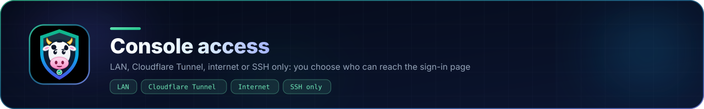
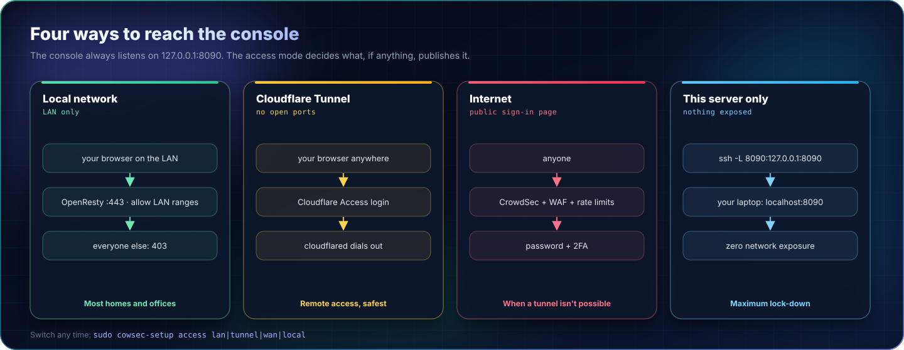
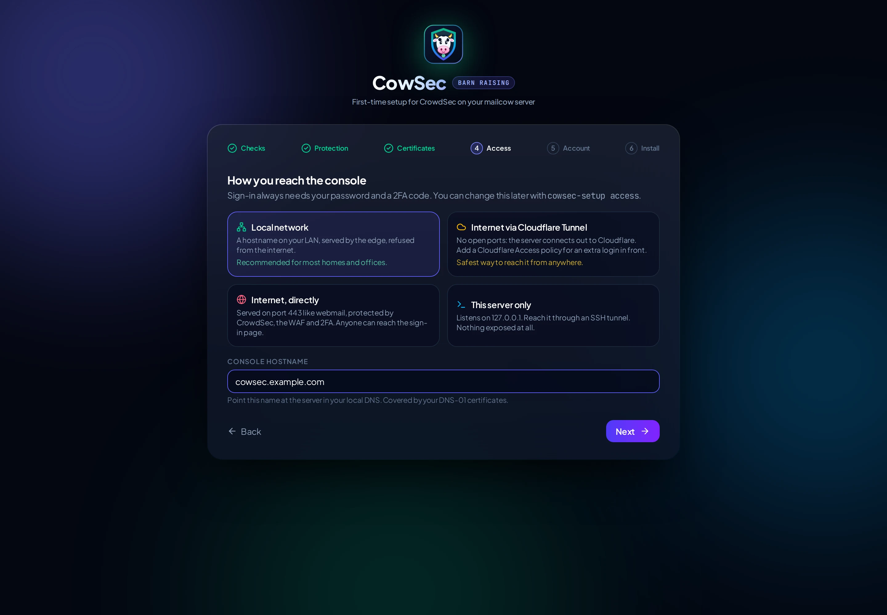

<p align="center"></p>

# Reaching the console

<p align="center"><a href="assets/full/access-modes.webp" title="Open full size"></a></p>

The console itself always listens on `127.0.0.1:8090`. How it is published depends on the access mode. Sign-in always needs a password **and** a second factor (TOTP or Duo), is rate-limited per IP and per user, and every change is written to the audit log.

| Mode | Who can reach it | What's exposed | Best for |
|---|---|---|---|
| `lan` | Your private networks only | `https://<hostname>` on port 443, served by the OpenResty edge with `allow <LAN ranges>; deny all` | Most homes and offices |
| `tunnel` | Anyone you let through Cloudflare | Nothing: `cloudflared` makes an **outbound** connection to Cloudflare | Remote access without opening ports |
| `wan` | The whole internet | `https://<hostname>` on 443 (already open for webmail), behind CrowdSec, the WAF and 2FA | When a tunnel isn't an option |
| `local` | Only people with SSH to the server | Nothing | Maximum lock-down |

Change mode at any time:

```bash
sudo cowsec-setup access lan --hostname cowsec.example.com
sudo cowsec-setup access tunnel --tunnel-token <token>
sudo cowsec-setup access local
```

## LAN

<p align="center"></p>

Point the hostname at the server in your **local** DNS (router, Pi-hole, AdGuard, Blocky...). The certificate comes from your DNS-01 setup. With mailcow's own Let's Encrypt, the hostname is added to `ADDITIONAL_SAN`, so it must also resolve publicly for the HTTP-01 check, even though the console then refuses non-LAN visitors.

Your LAN ranges default to the private ranges (`10/8`, `172.16/12`, `192.168/16`, `fc00::/7`). If you use the edge with Cloudflare's proxy, LAN checks use the real client IP.

## Cloudflare Tunnel (recommended for remote access)

1. In Cloudflare **Zero Trust → Networks → Tunnels**, create a tunnel (type *cloudflared*) and copy its token.
2. Choose *Cloudflare Tunnel* in the wizard (or `cowsec-setup access tunnel --tunnel-token …`). CowSec installs `cloudflared` from Cloudflare's signed repository and registers the tunnel as a service.
3. In the tunnel's **Public hostnames**, add for example `cowsec.example.com` → **HTTP** → `127.0.0.1:8090`.
4. **Strongly recommended:** under **Access → Applications**, add a self-hosted application for that hostname with a policy (your e-mail, an identity provider, a device posture...). Visitors then authenticate to Cloudflare before they ever see CowSec's sign-in page.

Why this beats a port forward: no new inbound port, Cloudflare absorbs scanning and DDoS, and Access puts a second, independent login in front. The trade-off is that console traffic is decrypted at Cloudflare's edge.

## Internet (direct)

The console is published on 443 next to webmail. Everything goes through CrowdSec's firewall bouncer, the OpenResty bouncer and the AppSec WAF, and sign-in requires 2FA. Anyone can still reach the sign-in page, so prefer a tunnel if you can.

## This server only

```bash
ssh -L 8090:127.0.0.1:8090 you@mail.example.com
# then browse to http://localhost:8090
```
