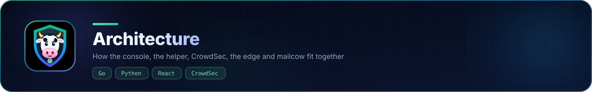

# How it fits together

| Component | Language | Role |
|---|---|---|
| `cowsec` | Go | HTTP API, sign-in, static UI; setup listener until setup completes |
| `cowsec-hostctl` | Python | The only privileged entry point: status, service actions, policy, updates, jobs |
| `setup_engine.py` | Python | Pre-flight checks and idempotent install steps (used by the wizard and `cowsec-setup`) |
| `cowsec-setup` | Python | Terminal front-end: token, checks, headless install, access changes, revert |
| `web/` | React + Tailwind | Console and setup wizard |

Data: `/var/lib/cowsec` (accounts, sessions, audit log, policy, job logs, certificates); `/etc/cowsec` (settings and secrets).
