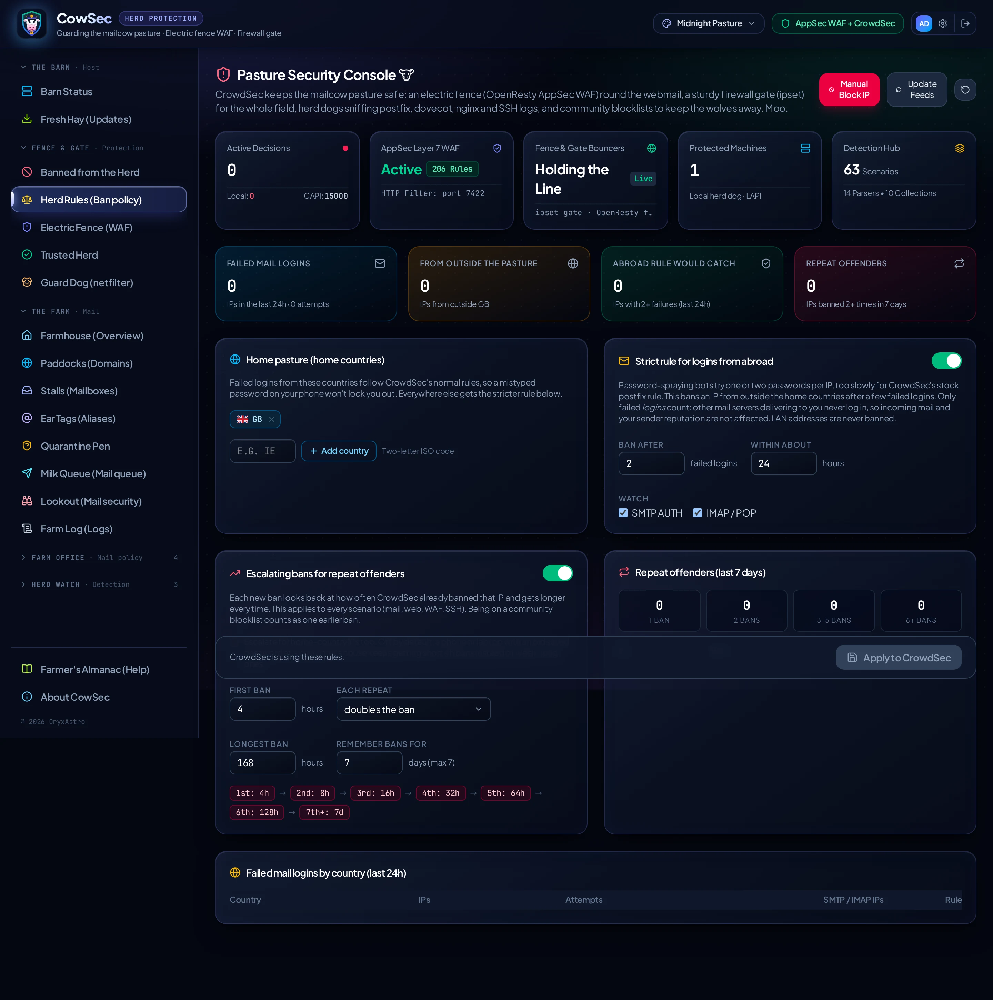
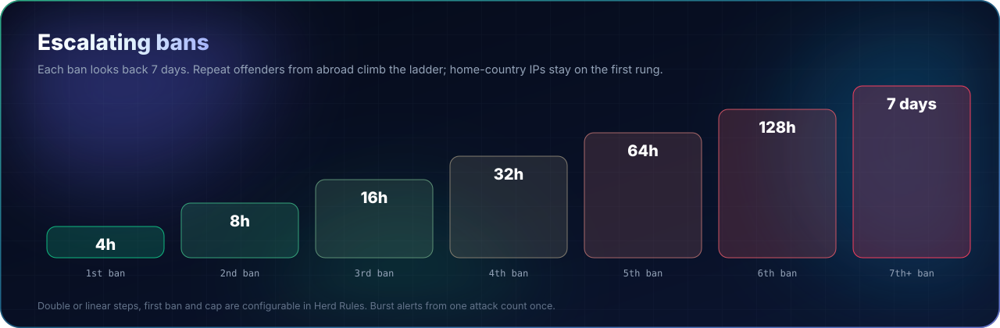
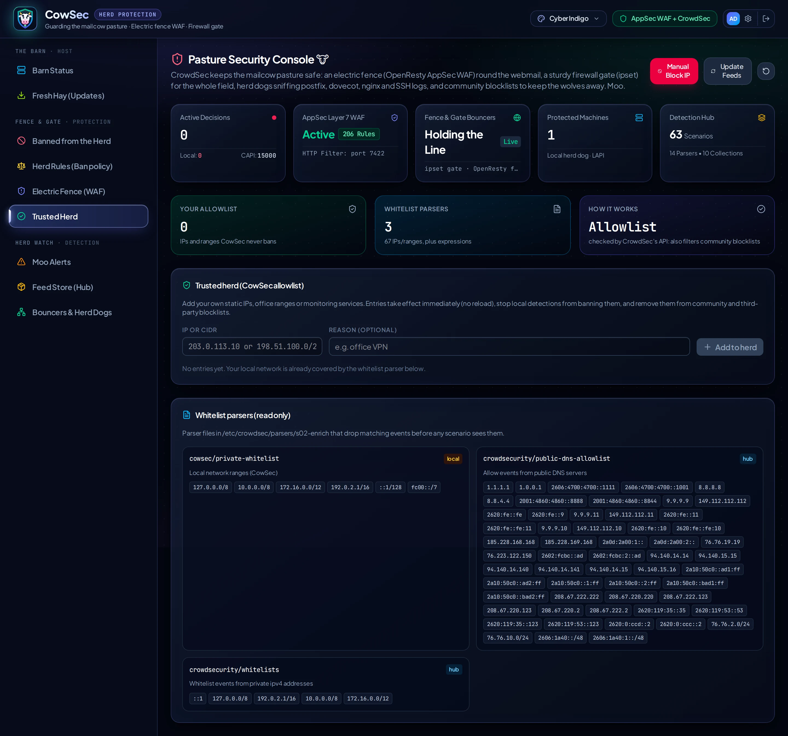

# Ban policy

Configure it in the console under **Herd Rules (Ban policy)**. CowSec writes it into CrowdSec's own configuration, tests it (`crowdsec -t`), reloads, and rolls back if CrowdSec rejects it.

## Home countries

Failed logins from your home countries follow CrowdSec's normal rules, so a typo on your phone doesn't lock you out of mail. Everything else is subject to the abroad rule below.

The setup wizard suggests a home country from your browser's time zone and asks you to confirm it. If the country your browser suggests isn't in the list, **Herd Rules** says so and offers to add it: otherwise your own failed logins fall under the abroad rule.

## Abroad rule: failed mail logins

Password-spraying botnets try one or two passwords per IP and rotate through thousands of IPs. CrowdSec's stock `postfix-spam` scenario needs several attempts within seconds, so they slip through. On a typical small server, over 90% of the IPs that fail SMTP AUTH try only once or twice.

The abroad rule (`cowsec/auth-abroad`) bans an IP from outside your home countries after **N failed logins within about H hours** (default 2 in 24h), for SMTP AUTH and/or IMAP/POP.

- **Only failed logins count.** Other mail servers delivering mail to you never authenticate, so incoming mail and your sender reputation are unaffected.
- **Private and LAN addresses are never banned.**
- **Use 2 or more.** With 1, a single typo while travelling bans that IP from everything, webmail included.

The page shows failed logins by country over the last 24 hours (looked up in the local GeoLite2 database), and how many IPs the rule would catch.

## Escalating bans

Each new ban looks at how often CrowdSec banned that IP in the last *N* days and gets longer: **double** (4h → 8h → 16h → … capped) or **linear** (4h → 8h → 12h → …). It applies to every scenario: mail, web, WAF, SSH.

This is done with CrowdSec profiles (`GetDecisionsSinceCount`), not extra scenarios, so it reflects real previous bans.

- **Home-country IPs keep the first-ban length by default.** A customer's phone with a stale saved password can trigger dozens of short bans a week from their home broadband. Escalating those would cut a whole household off for days. Tick *Escalate for home-country IPs too* if you want it anyway.
- **Being on a community blocklist counts as one earlier ban.**
- **The look-back is capped at CrowdSec's history** (`db_config.flush.max_age`, 7 days by default).

## Allowlists

**Trusted Herd** manages a CrowdSec **allowlist** called `cowsec`. Allowlists are checked by the Local API: they stop local detections and also filter community blocklist decisions, take effect immediately, and need no reload. Ranges broader than /8 (IPv4) or /16 (IPv6) are refused.

### Dynamic DNS hostnames

For a home connection whose address changes, point a dynamic DNS name at it (most routers can keep one updated) and add the name under **Dynamic DNS hostnames**. CowSec then:

- looks the name up every minute (`cowsec-dyndns.timer`, which only runs while a hostname is configured);
- trusts each public IPv4 address it points at, and each IPv6 address widened to its **/64** (the whole home network, since every device there uses its own address in that prefix) or kept exact if you choose;
- adds the addresses to the `cowsec` allowlist with the comment `dyndns:<hostname>` and an **expiry of one hour**, renewed while the name still points there. If CowSec stops checking, the trust lapses on its own instead of passing to whoever gets the address next;
- drops an address as soon as the name moves on, and unbans a new one straight away (allowlisting lifts CrowdSec's bans; CowSec also asks mailcow's netfilter to unban it);
- refuses doubtful answers: private, loopback or reserved addresses, and more than four addresses of either family (a hijacked or misconfigured record can't allowlist a crowd). If the name stops resolving, its last addresses stay until they lapse.

Before you rely on it:

- **Whoever can change the DNS record decides who CowSec trusts.** Protect the dynamic DNS account with a strong password and two-factor sign-in.
- **CGNAT.** If your provider uses carrier-grade NAT, your public IPv4 address is shared with other customers, and trusting it trusts them too. A router WAN address in `100.64.0.0/10` is the usual sign.
- Trusted addresses are never banned for anything, including by community blocklists.

With **Keep trusted lists in step** on (Guard Dog), the addresses reach mailcow's netfilter whitelist too, and leave it again when they're no longer trusted.
