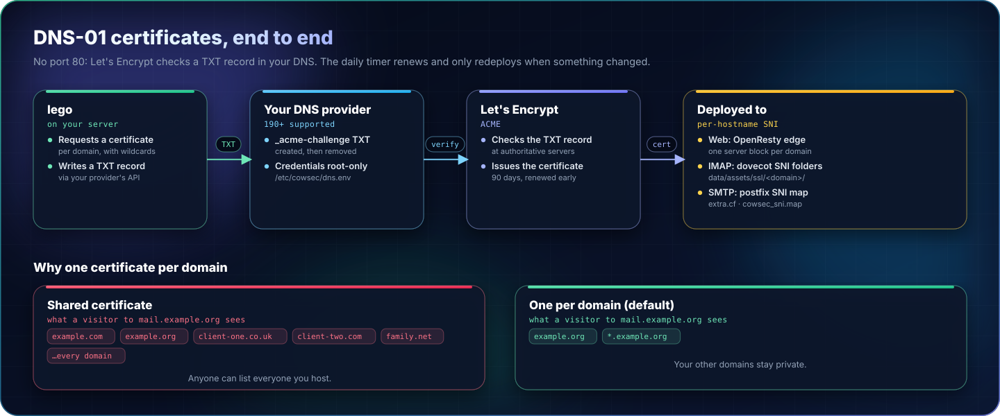
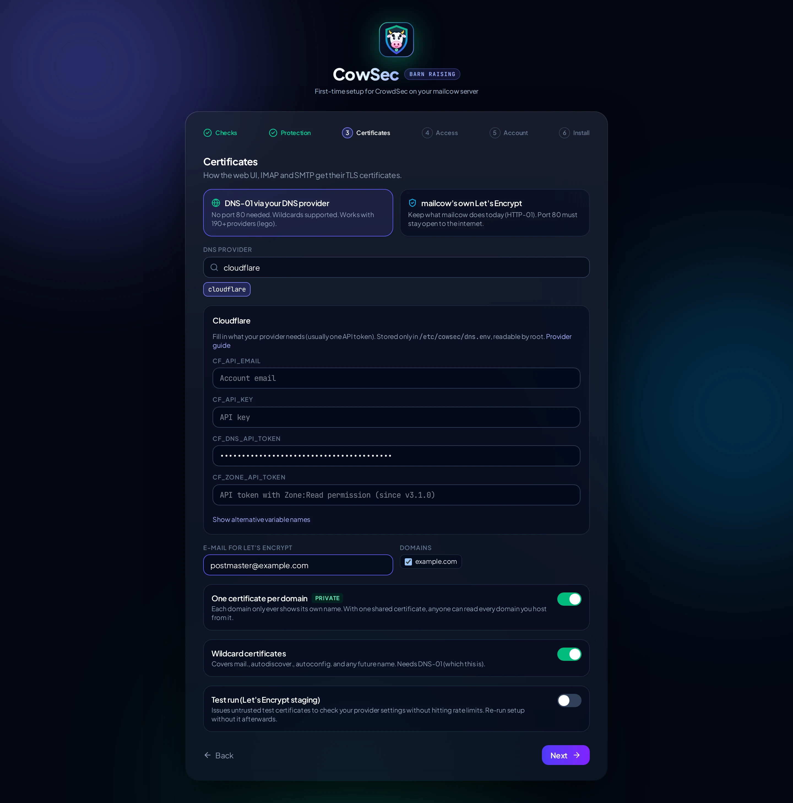

# Certificates

CowSec can leave certificates to mailcow (its built-in Let's Encrypt, HTTP-01 on port 80) or issue them itself with **DNS-01**.

## Why DNS-01

- **No port 80.** Let's Encrypt checks a TXT record in your DNS, not a web request, so you can close port 80 on your router.
- **Wildcards.** `*.example.com` covers `mail.`, `autodiscover.`, `autoconfig.` and any name you add later.
- **Any provider lego supports** (190+): Cloudflare, Route 53, DigitalOcean, Hetzner, OVH, Gandi, Porkbun, Namecheap, GoDaddy, Linode, Azure, Google Cloud, deSEC, PowerDNS, RFC2136 (BIND), and many more. The wizard reads each provider's required variables straight from lego, so the form always matches.

## Per-domain vs shared

| | One certificate per domain (default) | One shared certificate |
|---|---|---|
| What a visitor to `mail.example.org` sees | only `example.org` names | **every** domain on the server |
| Certificates | one per domain (+ one for the mailcow hostname if it isn't under them) | one |
| Adding a domain | the daily timer issues a certificate for it automatically | the shared certificate is re-issued |

Per-domain is more private: a shared certificate is a public list of everyone you host. Certificate Transparency logs show issued certificates either way, but per-domain certificates don't link your domains together.

### How they're served

| Service | How it picks the certificate |
|---|---|
| Web (OpenResty edge) | One `server` block per domain (`server_name .example.org`), plus a default. |
| IMAP/POP3 (dovecot) | mailcow's SNI folders: `data/assets/ssl/<domain>/{cert,key}.pem` + `domains`. |
| SMTP (postfix) | mailcow disables its SNI map when `SKIP_LETS_ENCRYPT=y`. CowSec adds `tls_server_sni_maps = hash:/opt/postfix/conf/cowsec_sni.map` through `data/conf/postfix/extra.cf`, mailcow's supported override file. |
| Clients without SNI | The default certificate: the one covering `MAILCOW_HOSTNAME`. |

## Credentials

Create the narrowest credential your provider allows. For Cloudflare, an **API token** with *Zone → DNS → Edit* on just your mail zones (`CF_DNS_API_TOKEN`). Credentials are stored in `/etc/cowsec/dns.env` (mode 0600, root). They are never shown in the UI or logs.

Use **Test run (staging)** the first time: it proves the credentials and DNS work without touching Let's Encrypt's production rate limits. The certificates it issues are untrusted, so re-run setup without it afterwards.

## DNS checks

lego confirms the challenge record at your domain's **authoritative** nameservers and uses public resolvers (`1.1.1.1`, `9.9.9.9`) for lookups. It deliberately ignores the server's own resolver, because routers, Pi-hole and similar caches keep an earlier "no such record" answer and stall the check. If outbound DNS to those resolvers is blocked, set `"resolvers": ["<your-resolver>:53"]` under `certs` in a headless config.

## Renewal

`cowsec-certs.timer` runs daily. It:

1. Renews certificates that are due (lego uses ARI / one-third-of-lifetime rules).
2. Issues certificates for **new mailcow domains** (per-domain mode).
3. Redeploys and restarts mailcow's postfix, dovecot and nginx **only if something changed**.

Run it by hand: `sudo systemctl start cowsec-certs.service && journalctl -u cowsec-certs -n 50`.

## Domains your provider doesn't manage

If a domain's DNS is somewhere else, its certificate request fails. The timer logs it and moves on; the other domains keep working. Either add credentials for that DNS host (one provider per installation today), or move the zone.
