<p align="center">
  <a href="assets/full/setup-flow.webp" title="Open full size"></a>
</p>

# Installation walkthrough

This guide follows real installations: one on a fresh Debian 12 server already running a stock mailcow-dockerized, and one on a bare Debian 12 server where CowSec installed mailcow too. It goes from the package to a protected server with the console signed in. Every screenshot comes from that run. Domains and addresses are replaced with `example.com` and `192.0.2.x`.

> [!TIP]
> **Bare metal, VPS or VM: it all works the same.** CowSec needs Debian 12/13 or Ubuntu 22.04/24.04 (amd64). It protects the mailcow you already have, or installs mailcow for you on a clean server. On KVM guests (Proxmox and most VPSs) it can also sync the clock to the hypervisor.

## Contents

1. [Install the package](#1-install-the-package)
2. [Open the setup wizard](#2-open-the-setup-wizard)
3. [Checking the pasture](#3-checking-the-pasture)
4. [Your mail server](#4-your-mail-server)
5. [Protection](#5-protection)
6. [Certificates](#6-certificates)
7. [Console access](#7-console-access)
8. [Your admin account](#8-your-admin-account)
9. [Review and install](#9-review-and-install)
10. [First sign-in and 2FA](#10-first-sign-in-and-2fa)
11. [A tour of the console](#11-a-tour-of-the-console)
---

## 1. Install the package

Download `cowsec_<version>_amd64.deb` and `SHA256SUMS` from the latest release, then:

```bash
sha256sum -c SHA256SUMS
sudo apt update && sudo apt install ./cowsec_<version>_amd64.deb
```

Installing the package changes nothing else on the server. It starts the `cowsec` service in **setup mode** and prints the wizard's address:

```text
  🐄 CowSec setup

  Open the setup wizard in your browser:

    https://192.0.2.10:9443

  Setup token:   3f9c…  (48 hex characters)
  Certificate SHA-256 (self-signed, check it matches your browser):
  9E:A1:5C:BB:…

  Port 9443 closes for good once setup is finished.
```

Run `sudo cowsec-setup` at any time to print it again.

## 2. Open the setup wizard

Browse to the address. The wizard uses a temporary self-signed certificate, so your browser warns once. Compare the fingerprint if you like, then continue. Paste the **setup token** to unlock it.

<p align="center"></p>

> [!NOTE]
> The token is 192 bits, stored root-only, and rate-limited against guessing. Nothing in the wizard works until it's unlocked.

## 3. Checking the pasture

Before changing anything, CowSec inspects the server. It checks:

- the OS and architecture;
- systemd, Docker and Compose;
- the mailcow installation, its running containers and its domains;
- which ports are in use;
- the `DOCKER-USER` firewall chain;
- clock sync and the optional hypervisor clock;
- disk space, and that the package repositories can be reached.

A **red** check blocks the install. **Amber** is advice.

<p align="center"></p>

## 4. Your mail server

Choose **Protect my existing mailcow**, or, on a server without mailcow, **Install mailcow, then protect it**.

<p align="center">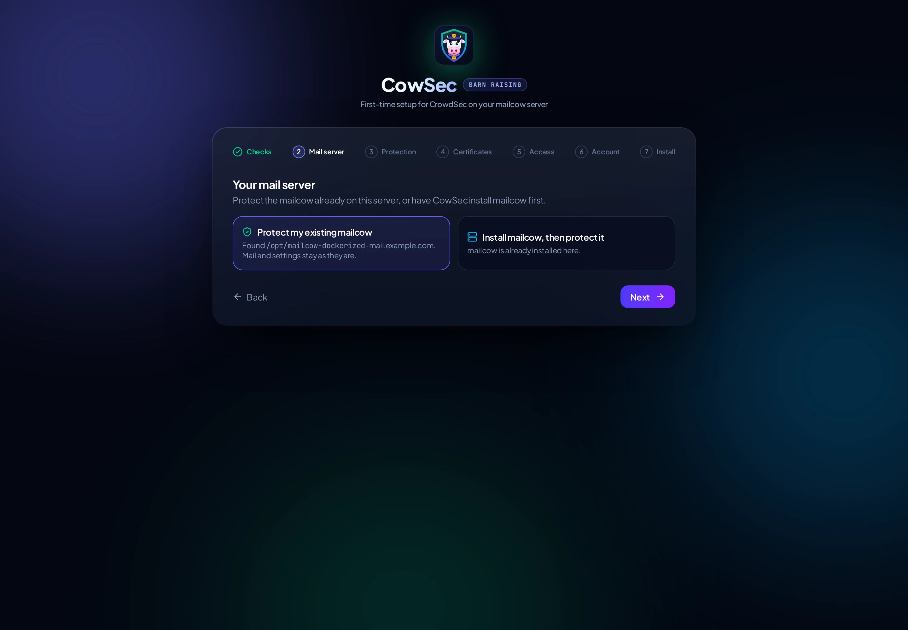</p>

On a server that already runs mailcow, **Protect my existing mailcow** is chosen for you. On a bare server, only the install option is available:

<p align="center">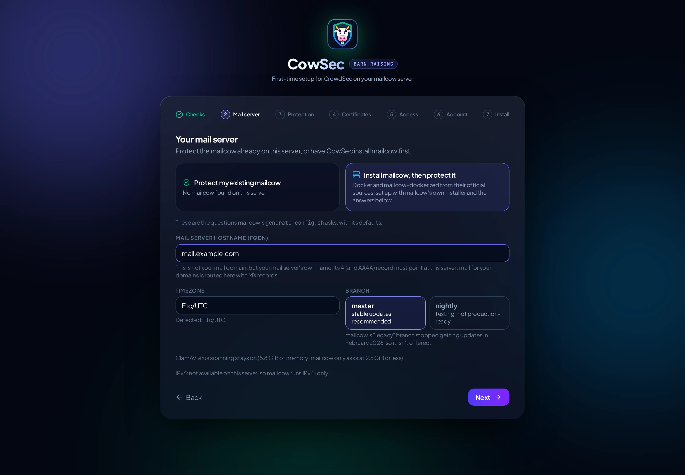</p>

To install, CowSec asks exactly the questions mailcow's own `generate_config.sh` asks, with the same defaults:

| Question | Notes |
|---|---|
| **Mail server hostname (FQDN)** | The server's own name, e.g. `mail.example.com`, not your mail domain. A name without a subdomain gets mailcow's own warning, and you must confirm it. |
| **Timezone** | Detected from the server. |
| **Branch** | `master` (stable, recommended) or `nightly` (testing). mailcow's `legacy` branch stopped getting updates in February 2026. |
| **Disable ClamAV** | Only asked at 2.5 GiB of memory or less, as mailcow does. |

IPv6 isn't a question: mailcow tests the server's IPv6 connectivity itself and enables it only if it works.

CowSec then installs Docker CE from Docker's official repository and clones mailcow-dockerized to `/opt/mailcow-dockerized`. It runs `generate_config.sh` with your answers, pulls the images and starts mailcow. Before any of that, the pre-flight checks:
- memory (6 GiB recommended);
- disk space;
- that the mail and web ports are free;
- that outbound port 25 isn't blocked;
- that Debian's old `docker.io` package isn't installed.

<p align="center">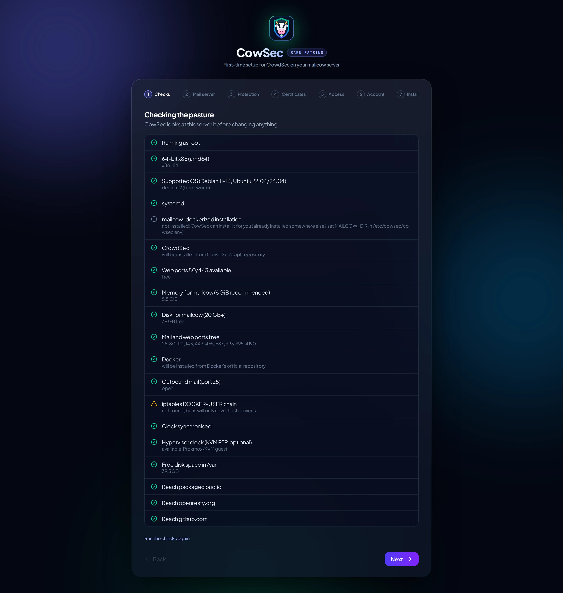</p>

> [!IMPORTANT]
> mailcow ships with a well-known default admin password. CowSec replaces it with a random one and shows it **once**, on the final screen. Save it, then sign in to mailcow and turn on 2FA there too.

<p align="center">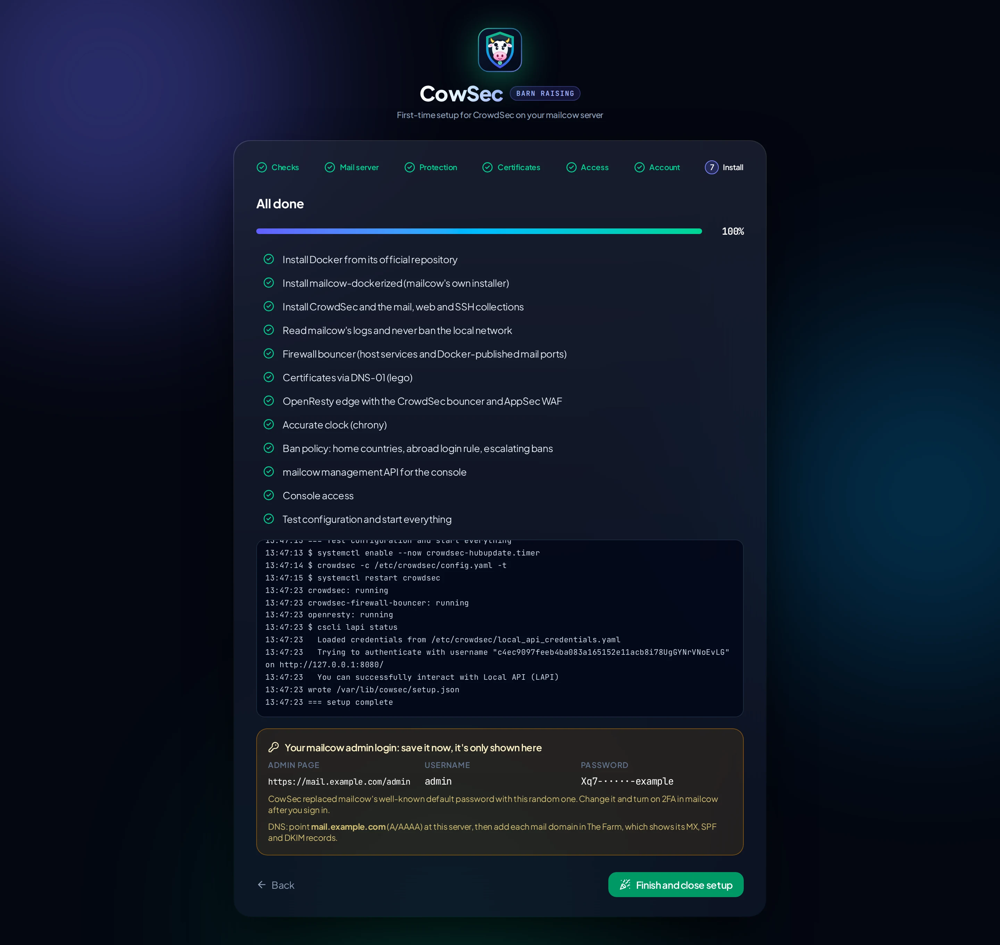</p>

If this server already has a hand-built setup, the pre-flight shows what CowSec found and will take over:
- certbot certificates;
- OpenResty sites;
- a CrowdSec that already reads mailcow's logs.

See [Servers that already run CrowdSec](install.md#servers-that-already-run-crowdsec-or-a-hand-built-setup).

## 5. Protection

CrowdSec, the mailcow log readers and the firewall bouncer are always installed. Choose the extras:

| Option | What it does |
|---|---|
| **Home countries** | Failed logins from here follow CrowdSec's normal rules. Defaults to your browser's country. |
| **OpenResty edge with AppSec WAF** | A hardened reverse proxy in front of mailcow's web UI. The CrowdSec bouncer and WAF check every request. mailcow's own web server moves to localhost. |
| **Admin pages on the local network only** | `/admin` and `/domainadmin` answer only from private addresses. Webmail and ActiveSync stay public. |
| **Behind Cloudflare's proxy** | Trusts `CF-Connecting-IP` from Cloudflare's ranges (refreshed monthly), so bans hit visitors rather than Cloudflare. |
| **Accurate clock** | chrony with internet NTP; on KVM guests it also uses the hypervisor's clock. |
| **Manage mailcow from CowSec** | Domains, mailboxes, aliases, DKIM, quarantine, queue and logs from the console, via mailcow's API (localhost only). |
| **Smart ban policy** | Stricter rule for failed logins from abroad, plus escalating bans for repeat offenders. |

<p align="center"></p>

## 6. Certificates

Pick **DNS-01** to get certificates through your DNS provider, with no port 80 and with wildcard support. Search for your provider among the 190+ that lego supports. The form shows exactly the credentials that provider needs.

<p align="center"></p>

> [!TIP]
> Keep **One certificate per domain** on. A shared certificate lists every domain you host to anyone who looks at it. Turn on **Test run** the first time to prove your credentials against Let's Encrypt's staging servers.

Prefer to keep mailcow's own Let's Encrypt? Choose that card instead: the edge passes HTTP-01 challenges through to mailcow and reloads when mailcow renews.

## 7. Console access

Choose how you'll reach the console once setup closes:

<p align="center"></p>

| Mode | Exposed | Best for |
|---|---|---|
| **Local network** | `https://<hostname>` on 443, refused from outside your LAN | Most homes and offices |
| **Cloudflare Tunnel** | Nothing: the server dials out to Cloudflare | Remote access without opening ports |
| **Internet, directly** | The sign-in page, behind CrowdSec, the WAF and 2FA | When a tunnel isn't an option |
| **This server only** | Nothing; use an SSH tunnel | Maximum lock-down |

See [access.md](access.md) for the details of each.

## 8. Your admin account

Create the first CowSec account. Passwords need 12+ characters. You'll enrol an authenticator app at your first sign-in.

<p align="center"></p>

## 9. Review and install

Check the summary, then **Install**.

If mailcow is already running on the server, a box explains the safety net and asks you to confirm you have a recent backup before **Install** becomes available. Any backup will do: a VM or cloud snapshot, your usual backup, or mailcow's own `helper-scripts/backup_and_restore.sh`. Before its first change, CowSec also saves mailcow's settings and certificates, CrowdSec's configuration and the firewall rules to `/var/backups/cowsec/pre-install-<time>.tar.gz`. `sudo cowsec-setup restore-mailcow` puts mailcow back exactly as it was, at any time.

<p align="center">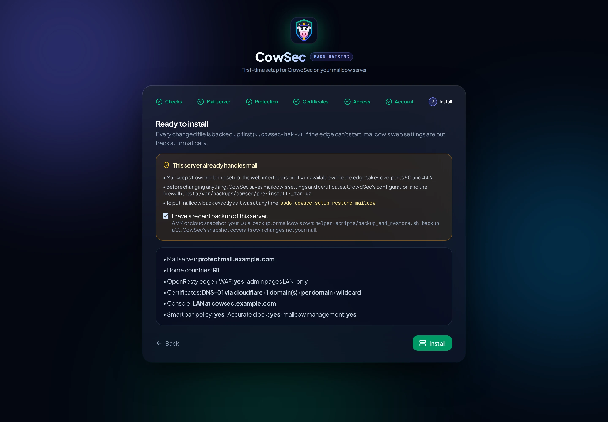</p>

Each step reports live, with the full log underneath. Every file CowSec changes is backed up first (`*.cowsec-bak-<time>`). If the edge can't start, mailcow's original web settings are restored automatically.

<p align="center"></p>

<p align="center">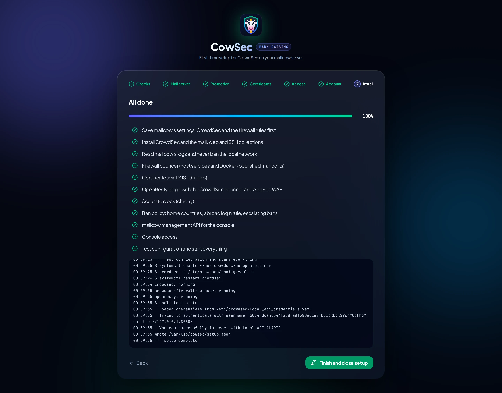</p>

**Finish and close setup** stops the wizard for good. Port 9443 closes.

<p align="center">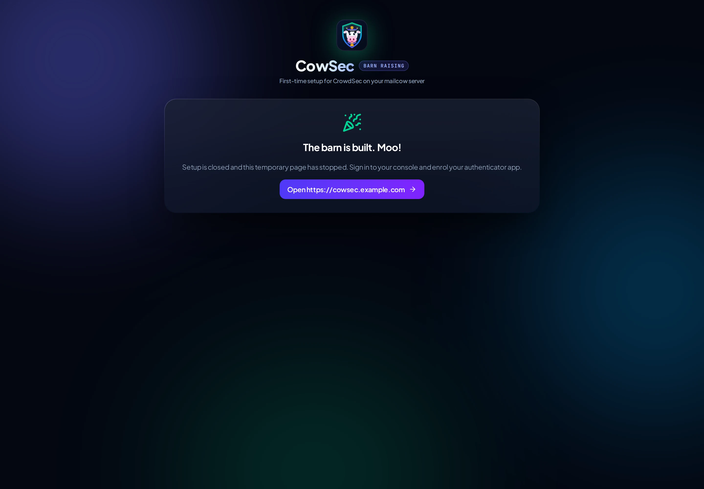</p>

## 10. First sign-in and 2FA

Open the console at the address you chose and sign in.

<p align="center"></p>

The first time, scan the QR code with an authenticator app (Microsoft Authenticator, Google Authenticator, 1Password, Bitwarden…) and enter the 6-digit code.

<p align="center"></p>

## 11. A tour of the console

The sidebar has five groups, each of which collapses:
- **The Barn:** the host.
- **Fence & Gate:** protection.
- **The Farm:** day-to-day mailcow management. See [Managing mailcow](mailcow.md).
- **Farm Office:** mail policy.
- **Herd Watch:** detection.

Help and About sit at the bottom.

### Barn Status

Health at a glance:
- services and timers;
- the firewall bouncer's ipsets;
- AppSec WAF traffic and top rules;
- log sources;
- certificate expiry;
- clock;
- mailcow containers.

It also has safe one-click service actions.

The **Pasture map** at the top shows live traffic:
- **Path:** from the internet, through the firewall gate and the OpenResty edge, to mailcow's web and mail ports.
- **Lines:** they speed up and thicken with traffic, and the gate sparks while it drops packets.
- **Boxes:** each one shows running totals, such as addresses banned, packets dropped, web requests stopped and mail log lines read.

<p align="center"></p>

### Fresh Hay (Updates)

Updates for **mailcow** (with an optional backup first), CrowdSec and its bouncers, and the hub, each run as an animated, staged job with health checks at the end. See [Maintenance](maintenance.md#updating-mailcow).

<p align="center">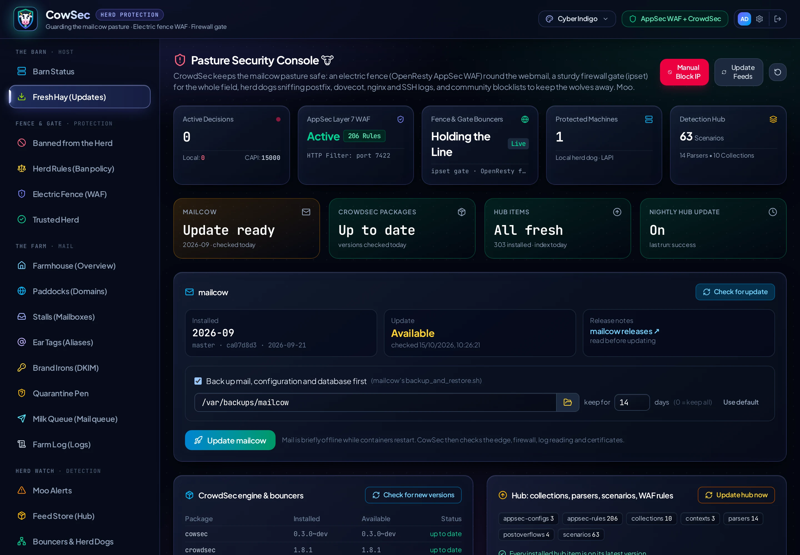</p>

### Herd Rules (Ban policy)

The page has these sections:
- **Home countries.**
- **Abroad login rule.**
- **Escalating ban ladder.**
- **Repeat offenders.**
- **Failed logins by country:** looked up in the local GeoLite2 database, so nothing leaves the server.

See [ban-policy.md](ban-policy.md).

<p align="center"></p>

### Banned from the Herd (Decisions)

Active bans with country, network and scenario. Search by IP, country or scenario, ban an IP by hand, or lift a ban.

<p align="center"></p>

### Electric Fence (Mail WAF)

CrowdSec ships around 200 AppSec rules, most for software a mail server doesn't run (WordPress plugins, firewalls, routers, Jira…). CowSec gives each rule one of three modes:

- **Block**: checked before the request reaches mailcow, and refused if it matches. This covers the rules for the mail stack (mailcow's PHP admin, webmail such as Roundcube or SOGo, Zimbra, Exchange, nginx) and probes that never belong on a mail server (`.env`, `.git`, debug consoles).
- **Watch**: checked after the reply has gone, so it never slows a request down or blocks a real visitor. Anything that trips a watch rule is probing for exploits, so CowSec bans it. These are the rules for software you don't run.
- **Off**: not installed.

New rules from hub updates start in Watch; new patches for mail products go straight to Block. Change any rule's mode on the page and your choice is kept across updates.

<p align="center"></p>

### Guard Dog (mailcow netfilter)

mailcow ships its own ban engine, netfilter. This page shows:
- its active and permanent bans;
- its recent activity;
- its thresholds, which you can edit.

It also sets how netfilter works with CrowdSec:
- **Side by side:** both ban independently.
- **CrowdSec enforces:** netfilter only detects, and its bans become CrowdSec decisions, so every ban appears in one list and follows your ban ladder.

Either way, your trusted networks are kept in netfilter's whitelist, and lifting a ban in **Banned from the Herd** lifts it in netfilter too. See [Managing mailcow](mailcow.md#guard-dog-mailcow-netfilter).

<p align="center"></p>

### Trusted Herd (Allowlists)

Your own allowlist, applied instantly by CrowdSec's API and also filtering community blocklists, plus a read-only view of the whitelist parsers.

<p align="center"></p>

### Moo Alerts, Feed Store (Hub), Bouncers & Herd Dogs

These three pages cover:
- **Moo Alerts:** recent alerts.
- **Feed Store:** the hub. Install, upgrade or remove collections, parsers, scenarios and postoverflows. It only lists items that matter on a mail server (mail, web server, SSH, Linux, firewall, log enrichment), though anything already installed always shows. WAF rules are under **Electric Fence**.
- **Bouncers & Herd Dogs:** registered bouncers and machines.

<p align="center"></p>
<p align="center"></p>
<p align="center"></p>

### Settings

Your account, authenticator reset and the sign-in activity log.

<p align="center"></p>

### Bessie the Bouncer

CowSec's mascot is **Bessie the Bouncer**, head of security. She dresses for the season. Each look is a hat plus a collar charm, kept inside the shield so she reads at any size:
- a security cap every day;
- a party hat at New Year;
- a love lock for Valentine's;
- bunny ears at Easter;
- sunglasses in July and August;
- a witch's hat at Halloween;
- a Santa hat in December.

In **Settings → Mascot** you can follow the calendar or pin any look. The choice is saved in your browser.

<p align="center">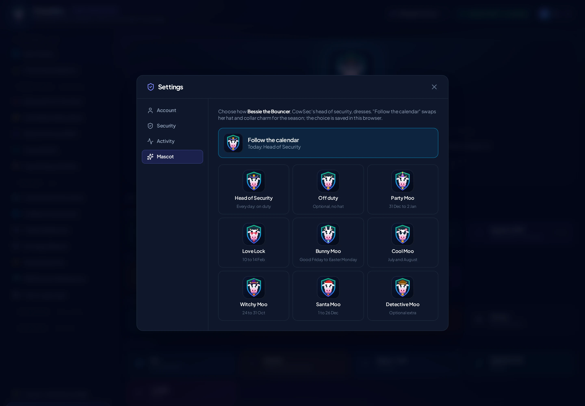</p>

### Themes

The palette menu in the header has six dark themes and four soft pastel light themes:
- **Dark:** Midnight Pasture, Alpine Dairy, Twilight Moo, Clover Night, Harvest Barn, Milky Way.
- **Light:** Strawberry Milk, Mint Meadow, Lavender Field, Buttercup Sky.

<p align="center">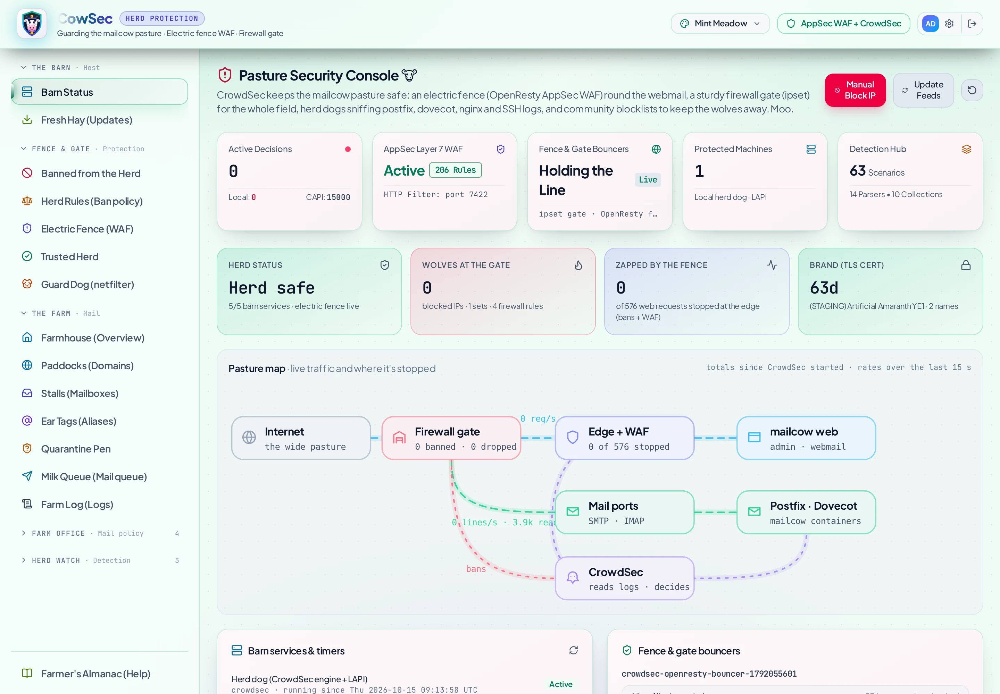</p>

### Farmer's Almanac and About

**Farmer's Almanac** is the in-app manual, knowledge base and troubleshooting guide. It is searchable and works offline. **About** shows:
- the version;
- the software CowSec is built on, with the installed versions;
- credits.

<p align="center">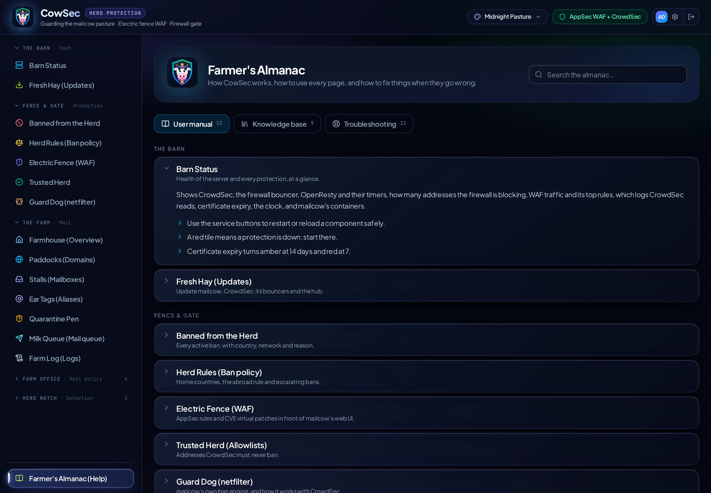</p>
<p align="center">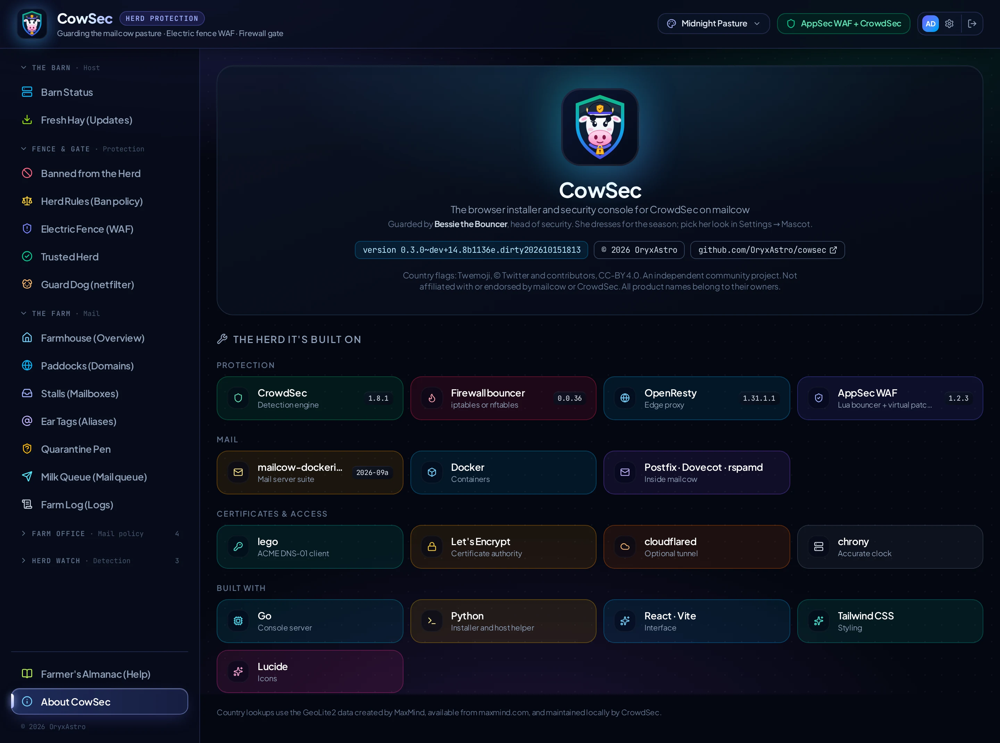</p>

---

**Next:** [Certificates](certificates.md) · [Ban policy](ban-policy.md) · [Security model](security.md) · [Maintenance](maintenance.md) · [Troubleshooting](troubleshooting.md)
