<p align="center">
  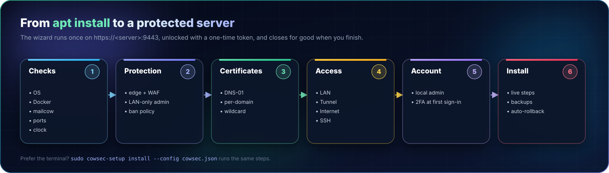
</p>

# Installation walkthrough

This guide follows a real installation on a fresh Debian 12 server running a stock mailcow-dockerized, from the package to a protected server with the console signed in. Every screenshot comes from that run. Domains and addresses are replaced with `example.com` and `192.0.2.x`.

> [!TIP]
> **Bare metal, VPS or VM: it all works the same.** CowSec needs Debian 11–13 or Ubuntu 22.04/24.04 (amd64), Docker with Compose v2, and mailcow already installed. On KVM guests (Proxmox and most VPSs) it can also sync the clock to the hypervisor.

## Contents

1. [Install the package](#1-install-the-package)
2. [Open the setup wizard](#2-open-the-setup-wizard)
3. [Checking the pasture](#3-checking-the-pasture)
4. [Protection](#4-protection)
5. [Certificates](#5-certificates)
6. [Console access](#6-console-access)
7. [Your admin account](#7-your-admin-account)
8. [Review and install](#8-review-and-install)
9. [First sign-in and 2FA](#9-first-sign-in-and-2fa)
10. [A tour of the console](#10-a-tour-of-the-console)

---

## 1. Install the package

Download `cowsec_<version>_amd64.deb` and `SHA256SUMS` from the latest release, then:

```bash
sha256sum -c SHA256SUMS
sudo apt install ./cowsec_<version>_amd64.deb
```

Installing the package changes nothing else on the server. It starts the `cowsec` service in **setup mode** and prints the wizard's address:

```text
  🐄 CowSec setup

  Open the setup wizard in your browser:

    https://192.0.2.10:9443

  Setup token:   3f9c…  (48 hex characters)
  Certificate SHA-256 (self-signed, check it matches your browser):
  9E:A1:5C:BB:…

  Port 9443 closes for good once setup is finished.
```

Run `sudo cowsec-setup` at any time to print it again.

## 2. Open the setup wizard

Browse to the address. The wizard uses a temporary self-signed certificate, so your browser warns once. Compare the fingerprint if you like, then continue. Paste the **setup token** to unlock it.

<p align="center"></p>

> [!NOTE]
> The token is 192 bits, stored root-only, and rate-limited against guessing. Nothing in the wizard works until it's unlocked.

## 3. Checking the pasture

Before changing anything, CowSec inspects the server. It checks:

- the OS and architecture;
- systemd, Docker and Compose;
- the mailcow installation, its running containers and its domains;
- which ports are in use;
- the `DOCKER-USER` firewall chain;
- clock sync and the optional hypervisor clock;
- disk space, and that the package repositories can be reached.

A **red** check blocks the install. **Amber** is advice.

<p align="center"></p>

## 4. Protection

CrowdSec, the mailcow log readers and the firewall bouncer are always installed. Choose the extras:

| Option | What it does |
|---|---|
| **Home countries** | Failed logins from here follow CrowdSec's normal rules. Defaults to your browser's country. |
| **OpenResty edge with AppSec WAF** | A hardened reverse proxy in front of mailcow's web UI. The CrowdSec bouncer and WAF check every request. mailcow's own web server moves to localhost. |
| **Admin pages on the local network only** | `/admin` and `/domainadmin` answer only from private addresses. Webmail and ActiveSync stay public. |
| **Behind Cloudflare's proxy** | Trusts `CF-Connecting-IP` from Cloudflare's ranges (refreshed monthly), so bans hit visitors rather than Cloudflare. |
| **Accurate clock** | chrony with internet NTP; on KVM guests it also uses the hypervisor's clock. |
| **Manage mailcow from CowSec** | Domains, mailboxes, aliases, DKIM, quarantine, queue and logs from the console, via mailcow's API (localhost only). |
| **Smart ban policy** | Stricter rule for failed logins from abroad, plus escalating bans for repeat offenders. |

<p align="center">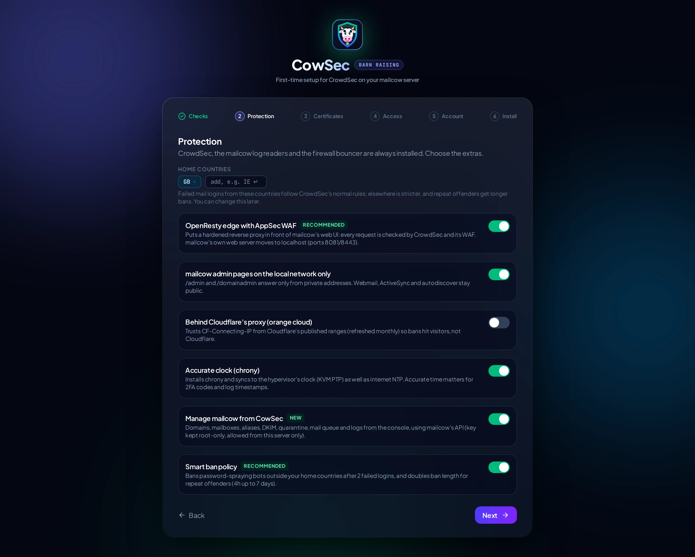</p>

## 5. Certificates

Pick **DNS-01** to get certificates through your DNS provider, with no port 80 and with wildcard support. Search for your provider among the 190+ that lego supports. The form shows exactly the credentials that provider needs.

<p align="center"></p>

> [!TIP]
> Keep **One certificate per domain** on. A shared certificate lists every domain you host to anyone who looks at it. Turn on **Test run** the first time to prove your credentials against Let's Encrypt's staging servers.

Prefer to keep mailcow's own Let's Encrypt? Choose that card instead: the edge passes HTTP-01 challenges through to mailcow and reloads when mailcow renews.

## 6. Console access

Choose how you'll reach the console once setup closes:

<p align="center"></p>

| Mode | Exposed | Best for |
|---|---|---|
| **Local network** | `https://<hostname>` on 443, refused from outside your LAN | Most homes and offices |
| **Cloudflare Tunnel** | Nothing: the server dials out to Cloudflare | Remote access without opening ports |
| **Internet, directly** | The sign-in page, behind CrowdSec, the WAF and 2FA | When a tunnel isn't an option |
| **This server only** | Nothing; use an SSH tunnel | Maximum lock-down |

See [access.md](access.md) for the details of each.

## 7. Your admin account

Create the first CowSec account. Passwords need 12+ characters. You'll enrol an authenticator app at your first sign-in.

<p align="center">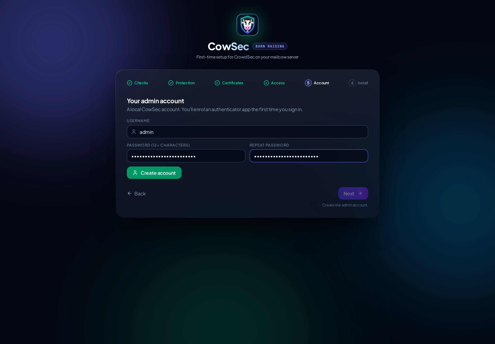</p>

## 8. Review and install

Check the summary, then **Install**.

<p align="center">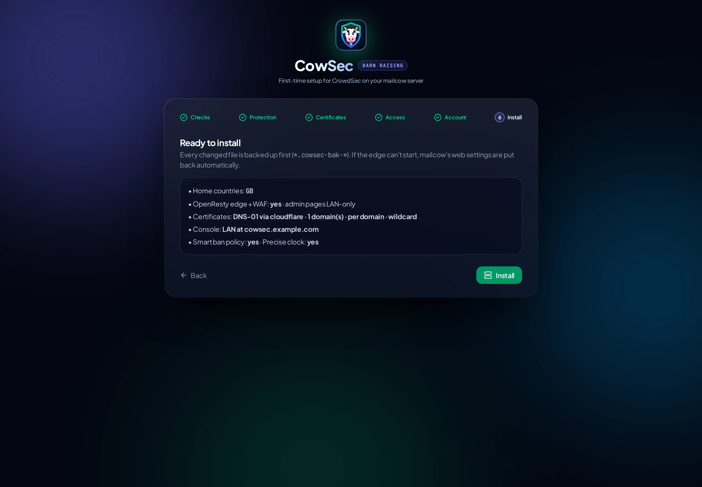</p>

Each step reports live, with the full log underneath. Every file CowSec changes is backed up first (`*.cowsec-bak-<time>`). If the edge can't start, mailcow's original web settings are restored automatically.

<p align="center">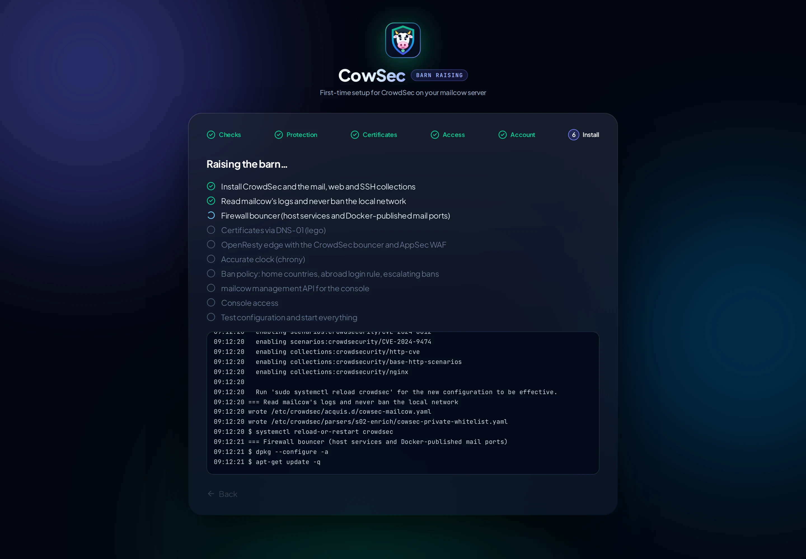</p>

<p align="center">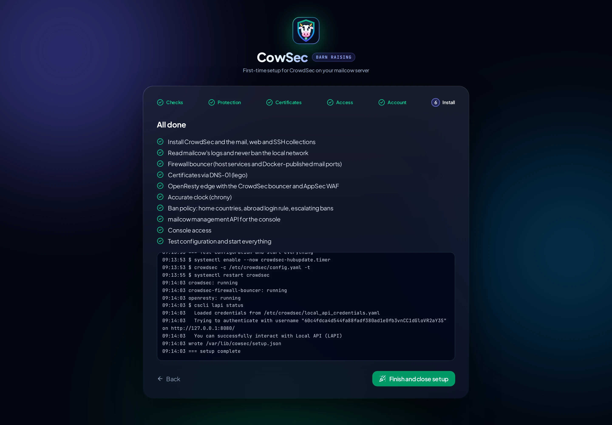</p>

**Finish and close setup** stops the wizard for good. Port 9443 closes.

<p align="center">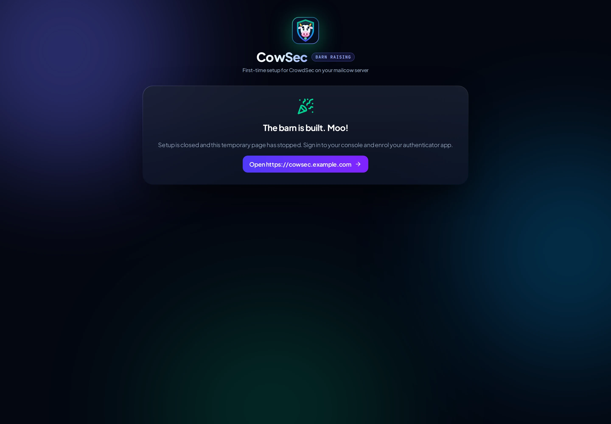</p>

## 9. First sign-in and 2FA

Open the console at the address you chose and sign in.

<p align="center">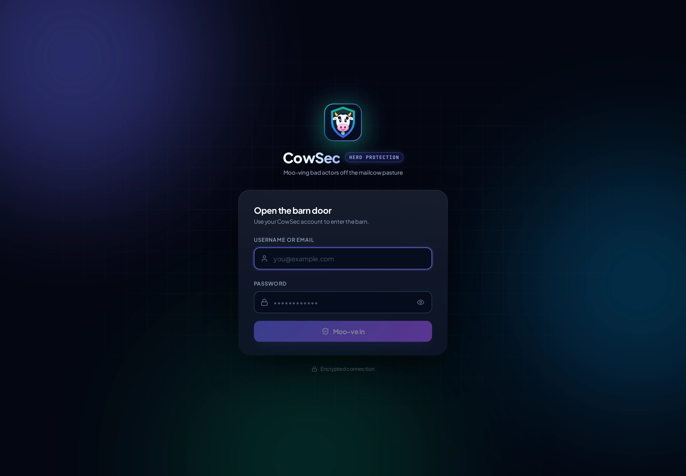</p>

The first time, scan the QR code with an authenticator app (Microsoft Authenticator, Google Authenticator, 1Password, Bitwarden…) and enter the 6-digit code.

<p align="center"></p>

## 10. A tour of the console

The sidebar has four groups: **The Barn** (the host), **Fence & Gate** (protection), **The Farm** (mailcow management, see [Managing mailcow](mailcow.md)) and **Herd Watch** (detection).

### Barn Status

Health at a glance:
- services and timers;
- the firewall bouncer's ipsets;
- AppSec WAF traffic and top rules;
- log sources;
- certificate expiry;
- clock;
- mailcow containers.

It also has safe one-click service actions.

<p align="center"></p>

### Fresh Hay (Updates)

Installed vs available versions for CrowdSec and its bouncers. Upgrades back up `/etc/crowdsec` and keep your config. This page also shows hub updates and the nightly auto-update switch.

<p align="center">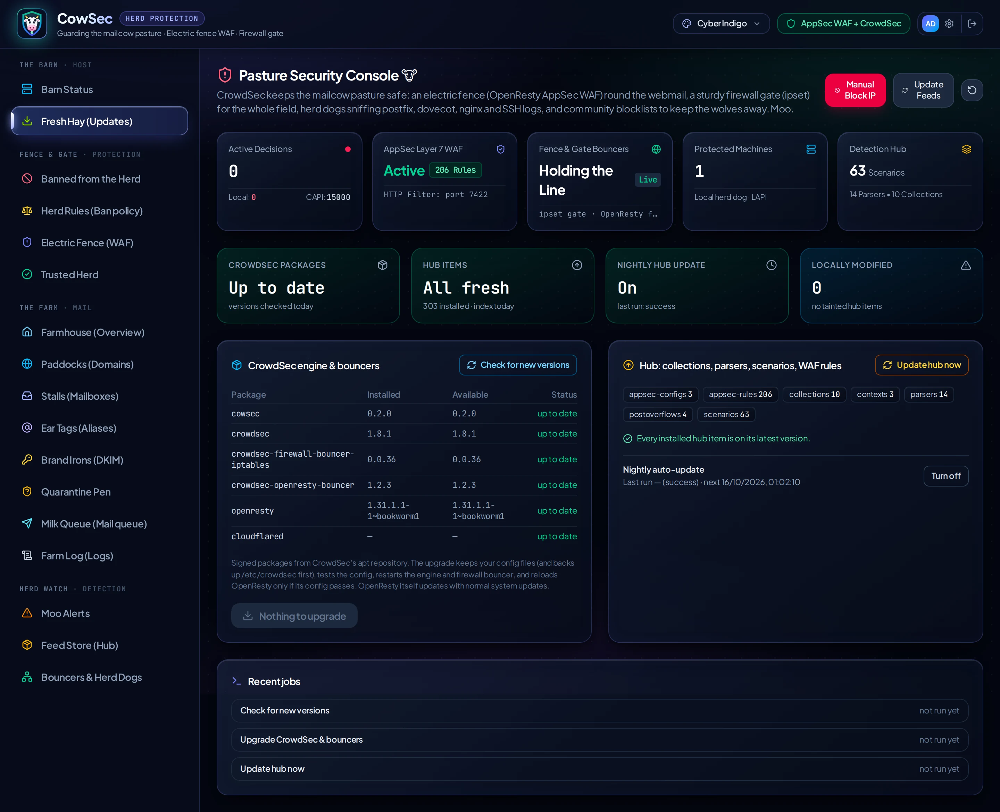</p>

### Herd Rules (Ban policy)

The page has these sections:
- **Home countries.**
- **Abroad login rule.**
- **Escalating ban ladder.**
- **Repeat offenders.**
- **Failed logins by country:** looked up in the local GeoLite2 database, so nothing leaves the server.

See [ban-policy.md](ban-policy.md).

<p align="center"></p>

### Banned from the Herd (Decisions)

Active bans with country, network and scenario. Search by IP, country or scenario, ban an IP by hand, or lift a ban.

<p align="center"></p>

### Electric Fence (AppSec WAF)

Every AppSec rule and CVE virtual patch, with filters and one-click toggles.

<p align="center"></p>

### Trusted Herd (Allowlists)

Your own allowlist, applied instantly by CrowdSec's API and also filtering community blocklists, plus a read-only view of the whitelist parsers.

<p align="center">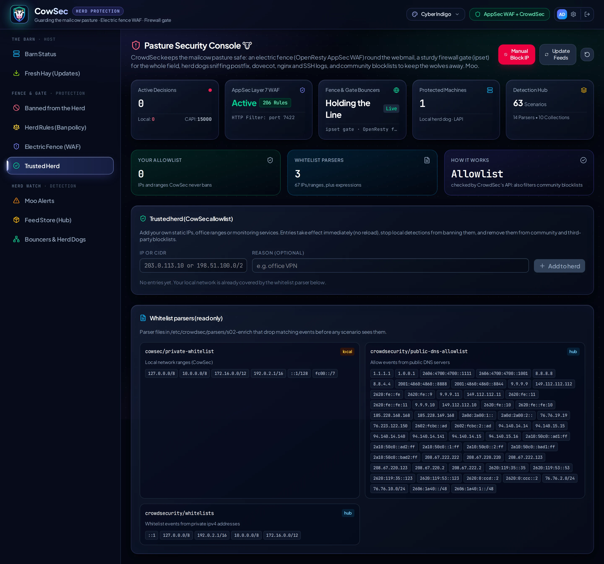</p>

### Moo Alerts, Feed Store (Hub), Bouncers & Herd Dogs

These three pages cover:
- **Moo Alerts:** recent alerts.
- **Feed Store:** the hub, where you install, upgrade or remove collections, parsers, scenarios and WAF rules.
- **Bouncers & Herd Dogs:** registered bouncers and machines.

<p align="center">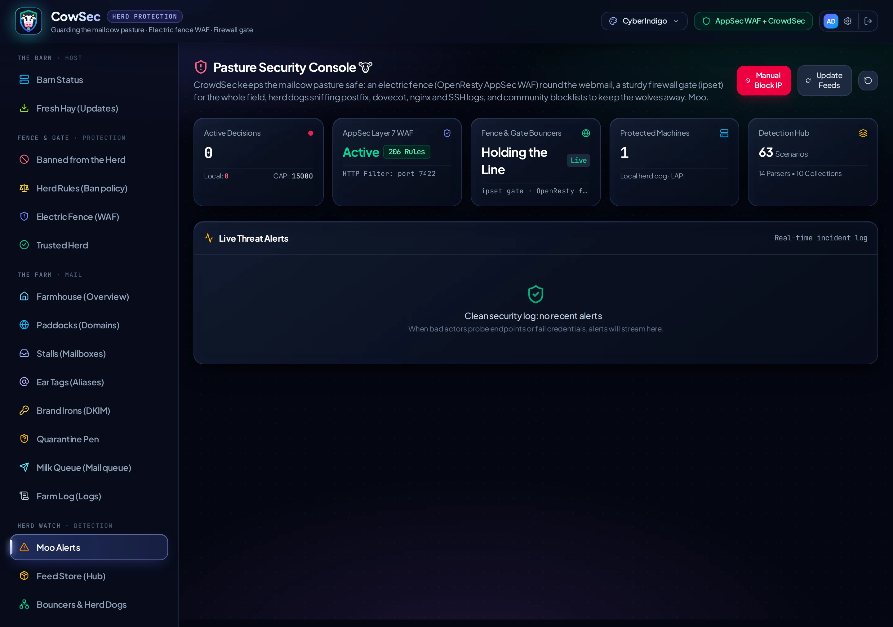</p>
<p align="center">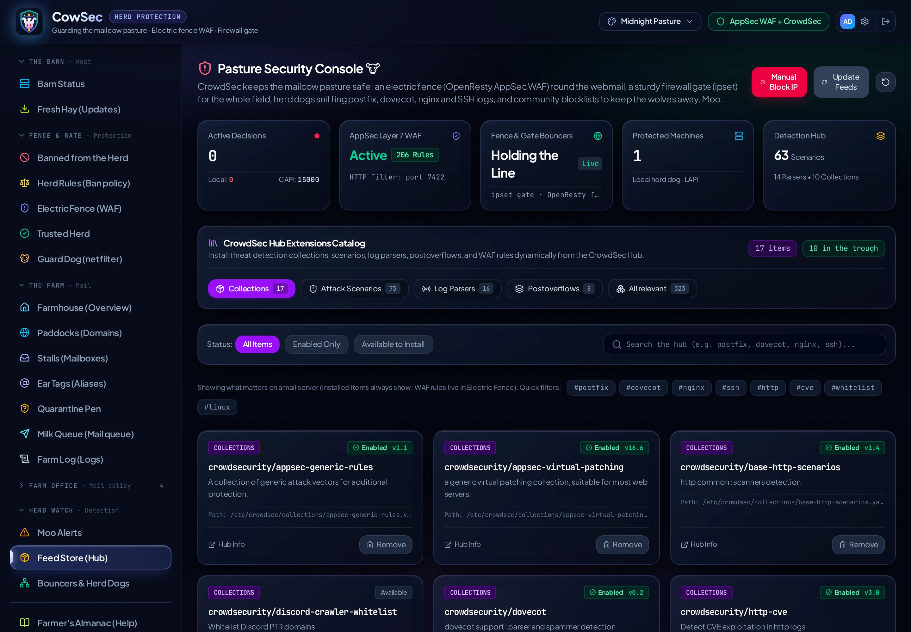</p>
<p align="center">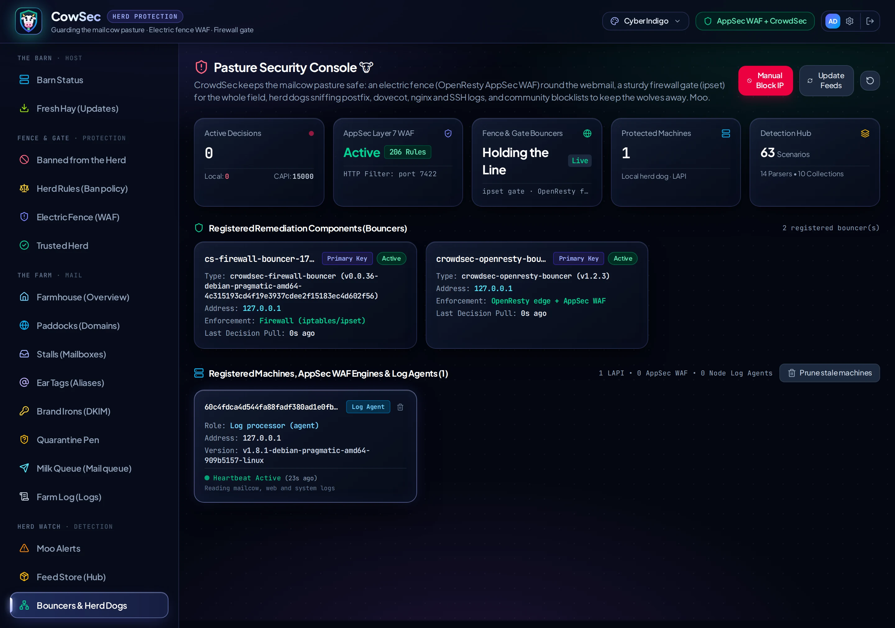</p>

### Settings

Your account, authenticator reset and the sign-in activity log.

<p align="center">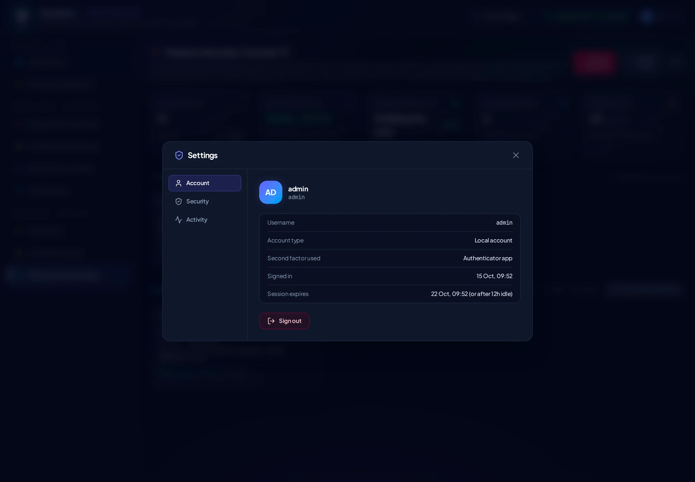</p>

---

**Next:** [Certificates](certificates.md) · [Ban policy](ban-policy.md) · [Security model](security.md) · [Maintenance](maintenance.md) · [Troubleshooting](troubleshooting.md)
