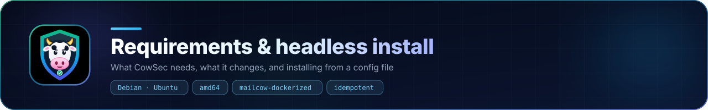

<p align="center"></p>

# Installing CowSec

> [!TIP]
> Want to see it first? The [installation walkthrough](guide.md) shows every wizard step with screenshots.

## Before you start

| Need | Why |
|---|---|
| Debian 12/13 or Ubuntu 22.04/24.04, amd64, systemd | Tested with a full install on each. On **Debian 13** the OpenResty edge and WAF aren't available yet: Debian 13 rejects OpenResty's package signing key because it still uses SHA-1 ([openresty#1072](https://github.com/openresty/openresty/issues/1072)), and CowSec won't weaken apt's checks to get around it. Everything else works; the console is reached through an SSH tunnel or a Cloudflare Tunnel there. Debian 11 has reached end of life and no longer gets security updates. |
| mailcow-dockerized, or a clean server | With an existing mailcow, CowSec reads its config (`mailcow.conf`), containers and domains. It looks in `/opt/mailcow-dockerized`, `/opt/mailcow` and `/srv/mailcow-dockerized`; set `MAILCOW_DIR` if yours lives elsewhere. On a clean server, the wizard can install Docker CE and mailcow for you (6 GiB of memory and 20 GB of disk recommended, ports 25, 80, 110, 143, 443, 465, 587, 993, 995 and 4190 free). |
| Root (sudo) | It installs packages, edits firewall and mailcow settings, and manages services. |
| Outbound HTTPS | To `packagecloud.io` (CrowdSec), `openresty.org` (OpenResty), `github.com` (lego, and mailcow when installing it), `download.docker.com` and `ghcr.io` (only when installing mailcow), `pkg.cloudflare.com` (only for Cloudflare Tunnel). |
| An accurate clock | 2FA codes depend on it. On Proxmox/KVM, the wizard can sync to the hypervisor's clock. |
| No other CrowdSec | If CrowdSec already runs **in a container** (e.g. a compose override), remove it first: two engines double-ban. A CrowdSec already installed on the host is reused. |
| Ports | If you enable the edge: 80/443 are taken over by OpenResty; mailcow's web server moves to `127.0.0.1:8180/8443`, as [mailcow's reverse-proxy guide](https://docs.mailcow.email/post_installation/reverse-proxy/r_p/) describes (its example HTTP port, 8080, is taken by CrowdSec; the guide forbids 8081, which installs before 0.3.10 used, and upgrading moves it). CowSec uses `127.0.0.1:8090` (console) and `:9443` (setup wizard, only until setup finishes). CrowdSec uses `127.0.0.1:8080` and `127.0.0.1:7422`. |

Back up before you start: a mailcow backup (`helper-scripts/backup_and_restore.sh`) and a VM snapshot if you can. CowSec also backs up every file it changes (`<file>.cowsec-bak-<timestamp>`).

## Installing on a server that already handles mail

CowSec is built to be added to a working mailcow server, and it was developed and tested on one. Still, this is a server people rely on, so:

1. **Back up first.** Any of these will do:
   - a VM or cloud snapshot, if your server is a virtual machine or VPS;
   - your usual backup;
   - mailcow's own backup, which works on any server, bare metal included: `sudo mkdir -p /var/backups/mailcow && cd /opt/mailcow-dockerized && sudo MAILCOW_BACKUP_LOCATION=/var/backups/mailcow ./helper-scripts/backup_and_restore.sh backup all`.

   CowSec saves its own "before" state (below), but that covers what CowSec changes, not your mail.
2. **Look before you leap.** `sudo cowsec-setup check` changes nothing; it shows what CowSec found and anything it would refuse.
3. **Pick a quiet time.** Mail keeps flowing throughout. mailcow's web interface (webmail, admin, autodiscover) is unavailable for about a minute while the edge takes over ports 80 and 443.
4. **Read the review step.** The wizard lists every choice before anything happens, and asks you to confirm you have a backup.

**The safety net:**
- Before the first change, CowSec saves mailcow's settings and certificates (`mailcow.conf`, `extra.cf`, `docker-compose.override.yml`, `data/assets/ssl`), CrowdSec's configuration and the current firewall rules to `/var/backups/cowsec/pre-install-<time>.tar.gz`.
- Every file it edits is also backed up next to the original as `<file>.cowsec-bak-<time>`.
- If the OpenResty edge can't start, mailcow's web settings are put back automatically.
- `sudo cowsec-setup restore-mailcow` puts mailcow back exactly as it was from the snapshot at any time. It stops the edge, restores those files, and restarts mailcow. CrowdSec keeps protecting the server; see [Uninstalling](maintenance.md#uninstalling) to remove it too.

## Install the package

```bash
sha256sum -c SHA256SUMS
sudo apt update && sudo apt install ./cowsec_<version>_amd64.deb
```

The package installs:

| Path | What |
|---|---|
| `/usr/bin/cowsec` | the console server |
| `/usr/sbin/cowsec-setup` | the setup and management command |
| `/usr/lib/cowsec/` | the privileged helper and the installer |
| `/usr/share/cowsec/ui` | the web UI |

It then starts the `cowsec` service and prints the setup address. **Nothing else is changed until you run the setup.**

## Run the setup wizard

```bash
sudo cowsec-setup
```

This prints `https://<server-ip>:9443`, a one-time **setup token**, and the SHA-256 fingerprint of the wizard's temporary self-signed certificate. Open the address, check the fingerprint if you like, accept the browser warning, and paste the token.

1. **Checks.** These are read-only: OS, Docker, mailcow, running containers, port owners, `DOCKER-USER`, clock, disk, network. Failed checks must be fixed first; warnings are advisory.
2. **Protection.**
   - Home countries.
   - OpenResty edge + AppSec WAF.
   - Admin pages LAN-only.
   - "Behind Cloudflare's proxy" (only if your web hostnames are orange-clouded).
   - Precise clock.
   - Smart ban policy.
3. **Certificates.** Choose DNS-01 (pick your provider, enter its API credentials, then pick domains, per-domain or shared, and wildcard) or keep mailcow's own Let's Encrypt. Use **Test run** first if you're unsure about the credentials. See [certificates.md](certificates.md).
4. **Access.** Local network, Cloudflare Tunnel, internet, or this server only. See [access.md](access.md).
5. **Account.** Your first admin. You'll set up an authenticator app at the first sign-in.
6. **Install.** Each step shows live progress and a log. If the edge can't start, mailcow's web settings are restored automatically.

Click **Finish**. The wizard listener closes, and the console starts the way you chose.

## Headless install

Write a config (same fields as the wizard) and run:

```bash
sudo cowsec-setup check
sudo cowsec-setup install --config cowsec.json
sudo cowsec auth local-admin set alice
```

```json
{
  "homeCountries": ["GB"],
  "components": { "edge": true, "adminLanOnly": true, "cloudflareRealIP": false, "chronyPtp": false, "banPolicy": true },
  "certs": {
    "mode": "dns01",
    "provider": "cloudflare",
    "credentials": { "CF_DNS_API_TOKEN": "…" },
    "email": "admin@example.com",
    "domains": ["example.com", "example.org"],
    "perDomain": true,
    "wildcard": true,
    "staging": false
  },
  "access": { "mode": "lan", "hostname": "cowsec.example.com" },
  "lanRanges": ["10.0.0.0/8", "172.16.0.0/12", "192.168.0.0/16", "fc00::/7", "127.0.0.0/8", "::1/128"]
}
```

To install mailcow as well, add `"mailcow": { "mode": "install", "hostname": "mail.example.com", "timezone": "Europe/London", "branch": "master", "skipClamd": false }`. Use `"acceptNoSubdomain": true` for a hostname without a subdomain. The default is `{ "mode": "existing" }`.

`certs` can be `{ "mode": "mailcow" }`. For a tunnel, use `"access": { "mode": "tunnel", "tunnelToken": "…" }`. Delete the file afterwards: it holds secrets.

## Servers that already run CrowdSec or a hand-built setup

The pre-flight looks at what is actually running, not where it was installed, and sorts it into three groups.

**Kept and built on:**
- CrowdSec installed from its apt repository, whatever repo file name you used. Your collections, scenarios, allowlists and `profiles.yaml` are kept; the original profile is saved as `profiles.yaml.pre-cowsec`.
- An installed firewall bouncer, iptables or nftables. CowSec never swaps one for the other.
- A local API on a non-default address.

**Taken over by the `adopt` step** (originals saved in `/root/cowsec-adopted-<time>/`):
- OpenResty sites that CowSec's edge replaces;
- a Cloudflare real-IP timer;
- a KVM clock config;
- CrowdSec log sources that already read mailcow's containers, which would otherwise count every event twice.

Existing certbot certificates can be kept as they are (**Keep my current certificates**). If you switch to DNS-01, certbot's renewal timers and deploy hooks are turned off, and `/etc/letsencrypt` itself is left untouched.

**Refused, with the reason** (no changes made):
- A CrowdSec container. Two engines would read the same logs and fight over bans.
- A CrowdSec binary placed by hand rather than installed by apt.
- An agent-only server that reports to a central CrowdSec elsewhere. Multi-server setups aren't supported yet.

Also shown, as advice:
- iptables-legacy, where Docker may be using the other backend;
- ufw or firewalld, whose reloads can drop the bouncer's rules until it restarts.

An earlier hand-installed CowSec (a unit in `/etc/systemd/system` running `/opt/cowsec`) is migrated by the package itself:
- the old unit, binary and helper move to `/root/cowsec-legacy-<time>/`;
- settings are renamed to the packaged names;
- accounts, 2FA and the ban policy are kept.

## What the installer changes

| Step | Changes |
|---|---|
| CrowdSec | Adds the CrowdSec apt repo (signed); installs `crowdsec`; installs the mail, web, SSH and Linux collections. |
| Detection | `/etc/crowdsec/acquis.d/cowsec-mailcow.yaml` (postfix + dovecot via Docker; web logs from OpenResty or nginx-mailcow); `parsers/s02-enrich/cowsec-private-whitelist.yaml` (your LAN). |
| Firewall | Keeps an installed bouncer. Otherwise installs `crowdsec-firewall-bouncer-iptables`. iptables bouncer: `iptables_chains: [INPUT, DOCKER-USER]`. nftables bouncer: `nftables_hooks: [input, forward]`. Both point at the local API that `local_api_credentials.yaml` names. |
| Certificates | lego (pinned, checksum-verified) in `/usr/lib/cowsec/lego`. Secrets: `/etc/cowsec/dns.env` (root only). Certificates are copied into `data/assets/ssl/` (main + per-domain SNI folders) and `data/conf/postfix/extra.cf` + `cowsec_sni.map`. `SKIP_LETS_ENCRYPT=y`. Renewal runs on `cowsec-certs.timer`. |
| Edge | OpenResty repo + `openresty`, `crowdsec-openresty-bouncer`; `/usr/local/openresty/nginx/conf/{nginx.conf,cowsec_mailcow_proxy.conf,sites/cowsec-mailcow.conf}`; AppSec on `127.0.0.1:7422`; mailcow.conf `HTTP_BIND/HTTPS_BIND=127.0.0.1`, `HTTP_PORT=8180`, `HTTPS_PORT=8443`. |
| Cloudflare real IP | `cowsec-cloudflare-realip.timer` (monthly), writes `conf.d/cloudflare_realip.conf`. |
| Clock | chrony + `ptp_kvm` + `/etc/chrony/conf.d/cowsec-ptp.conf`. |
| Ban policy | `/etc/crowdsec/profiles.yaml` (original kept as `profiles.yaml.pre-cowsec`) and `scenarios/cowsec-auth-abroad.yaml`. |
| Access | `sites/cowsec-console.conf` (LAN/internet), or cloudflared + its service (tunnel); `/etc/cowsec/cowsec.env`. |

Everything under mailcow's directory survives `update.sh`. mailcow's own files are only changed through its supported override points (`mailcow.conf`, `data/conf/postfix/extra.cf`, `data/assets/ssl`).
