<p align="center"></p>

# Managing mailcow from CowSec

<p align="center"><a href="assets/full/mailcow-flow.webp" title="Open full size">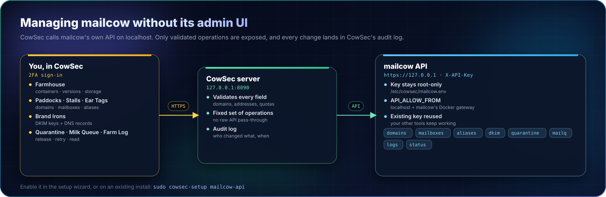</a></p>

CowSec can run the day-to-day mailcow administration itself, so you rarely need mailcow's admin UI. With that UI limited to your LAN, or closed altogether, admin access goes through CowSec's 2FA sign-in, audit log and WAF.

The pages live under **The Farm · Mail** in the sidebar.

| Page | What you can do |
|---|---|
| **Farmhouse** | Container health, mailcow version, storage, queue and quarantine at a glance |
| **Paddocks (Domains)** | Add, edit, enable/disable and delete domains; limits, quotas, relaying; a live **DNS records** checklist with DKIM |
| **Stalls (Mailboxes)** | Add mailboxes with a generated password, reset passwords, enable/disable, delete; quotas and last logins |
| **Ear Tags (Aliases)** | Forwarding addresses and catch-alls (`@example.org`) |
| **Quarantine Pen** | Release or delete messages rspamd held back |
| **Milk Queue (Mail queue)** | See stuck outgoing mail with the reason, retry, hold or delete |
| **Farm Log (Logs)** | postfix, dovecot, rspamd, SOGo, netfilter, ACME and more, with a filter |
| **Farmhands (Domain admins)** | Domain administrators, their domains and exactly which permissions they have |
| **Grazing Limits (Rate limits)** | Messages per second/minute/hour/day for each domain and mailbox |
| **Locked Lanes (TLS policy)** | Require TLS, a verified certificate or DANE for particular destinations |
| **Cattle Routes (Relays)** | Relay hosts (smarthosts) per domain, and transport maps per destination |
| **Guard Dog (netfilter)**, under Fence & Gate | mailcow's own ban engine, and how it works with CrowdSec |

## Turning it on

New installs: leave **Manage mailcow from CowSec** switched on in the setup wizard's *Protection* step.

Existing installs:

```bash
sudo cowsec-setup mailcow-api
```

This step does four things:
- **Reuses your key:** if mailcow already has an `API_KEY` in `mailcow.conf`, CowSec uses it, so your other tools keep working. Otherwise it generates one.
- **Allows local callers only:** `API_ALLOW_FROM` gains just `127.0.0.1`, `::1` and mailcow's Docker gateway (usually `172.22.1.1`). Calls from anywhere else are refused.
- **Stores the key root-only:** the key goes in `/etc/cowsec/mailcow.env` (mode 0600). It is never sent to the browser.
- **Applies the change:** if `mailcow.conf` changed, mailcow is restarted with `docker compose up -d`.

> [!IMPORTANT]
> mailcow's read-write API key is full administrative access to all mail on the server. CowSec only exposes a fixed set of validated operations. It never passes raw API calls through from the browser, and every change is recorded in CowSec's audit log (**Settings → Activity**).

## A tour

### Farmhouse

<p align="center"></p>

### Paddocks (Domains)

Add or edit a domain with its limits, quotas, tags, a sending limit, the global address list and backup-MX relaying. mailcow creates a DKIM key for new domains automatically.

Editing a domain adds three more tabs:
- **Footer:** a disclaimer or legal block added to every message the domain sends. HTML and plain-text versions, a live preview (shown in a sandbox, like a mail client would), "leave replies alone", and addresses that never get it.
- **Alias domains:** other domains that mirror this one, so mail to alice@*alias* reaches alice@*domain*.
- **Allow / block senders:** senders every mailbox at the domain always accepts (skipping the spam filter) or always refuses.

<p align="center"></p>

<p align="center">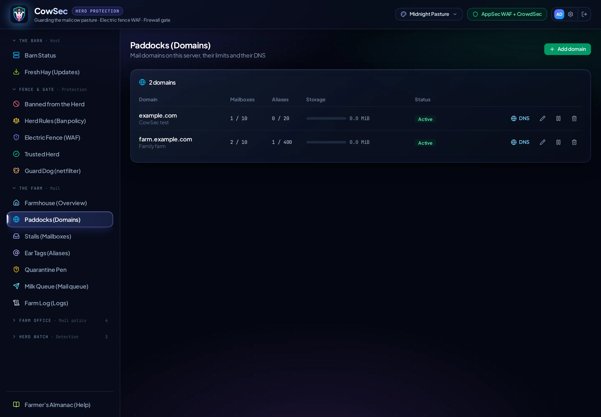</p>

**Add domain** opens a wizard. It creates the domain with mailcow's defaults and a DKIM key, lists exactly the records to publish and ticks each one off as DNS picks it up (it checks every 20 seconds), then makes the postmaster mailbox with a strong password. **All options** opens the full form instead.

<p align="center"></p>

The domain's **MTA-STS** tab publishes a policy telling other servers to always use an encrypted, verified connection to it. Start in testing, then switch to enforce. It lists the `mta-sts` and `_mta-sts` records to publish (also in the DNS checklist, checked live); CowSec's DNS-01 certificates cover `mta-sts.<domain>`.

<p align="center">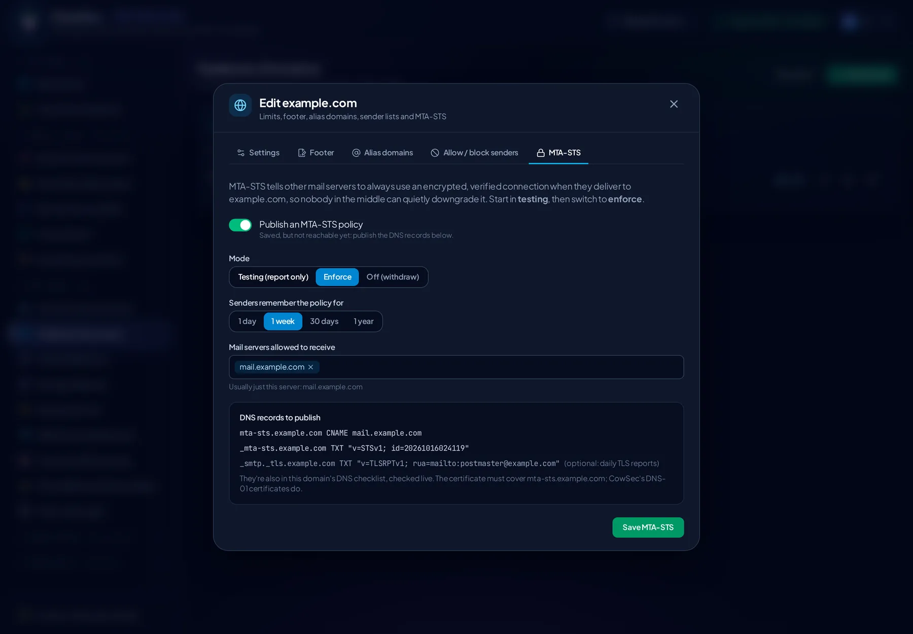</p>

#### DNS records

The **DNS** button on each domain opens its checklist. It lists every record mailcow needs, with what DNS answers right now:
- the server's address and reverse DNS (PTR);
- TLSA for DANE (optional);
- MX, SPF and DMARC;
- the DKIM key;
- autodiscover/autoconfig and SRV records for mail clients (optional).

Each value has a copy button. The whole set downloads as a zone file. The expected TLSA value is calculated from the certificate Postfix actually presents.

The **DKIM signing key** card in the checklist creates a key (choose the selector and 2048, 3072 or 4096 bits), copies a key to other domains, or deletes it. **Rotate key** changes the key without a gap in signing:
1. CowSec makes a new key under a new selector. Nothing changes yet, and the private key is held in memory only.
2. You publish its DNS record. CowSec checks DNS every 20 seconds until it appears.
3. mailcow switches to the new key. Keep the old record for about a week so messages already sent still verify.

<p align="center"></p>

### Stalls (Mailboxes)

The mailbox form has every option mailcow offers:
- the full name, a generated password, and a forced password change at next sign-in;
- quota and tags;
- tagged-mail handling (`me+news@`);
- quarantine notifications and their category;
- required TLS, incoming and outgoing;
- which protocols may sign in: IMAP, POP3, SMTP, Sieve, ActiveSync and DAV;
- webmail access and a relay host;
- required two-factor sign-in;
- which From addresses it may use: only its own, specific addresses and domains, or any address.

**Edit** opens the same form, pre-filled, with four more tabs:
- **Spam filter:** where this mailbox draws its lines: inbox below the first score, Junk folder between the two, rejected above the second. Presets for strict, default and relaxed.
- **App passwords:** a separate password per app or device, limited to the protocols it needs. CowSec generates it and shows it once; pause or revoke it without touching the main password.
- **Disposable addresses:** throwaway addresses that deliver to the mailbox, lasting a day, a week, a month, a year or forever. When one starts getting spam you can see who leaked it and turn it off.
- **Allow / block senders:** per-mailbox allow and block lists.

The key button sets a new password at any time.

<p align="center">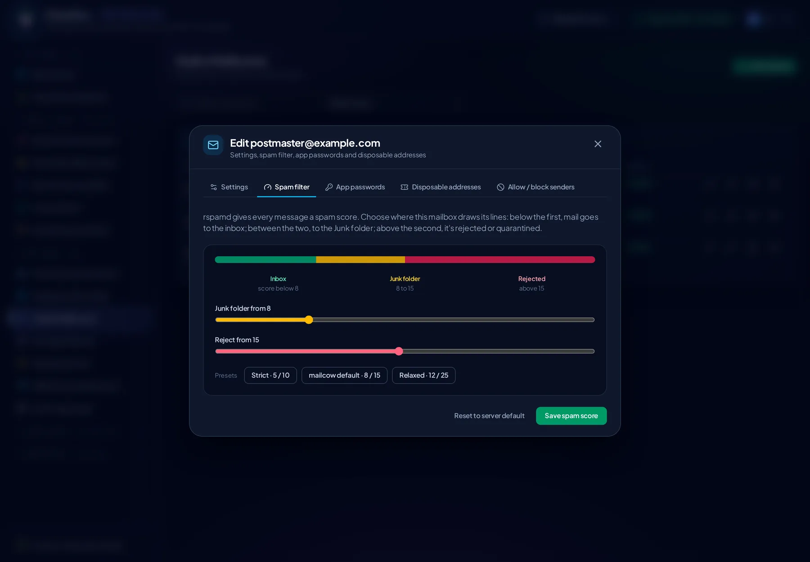</p>
<p align="center">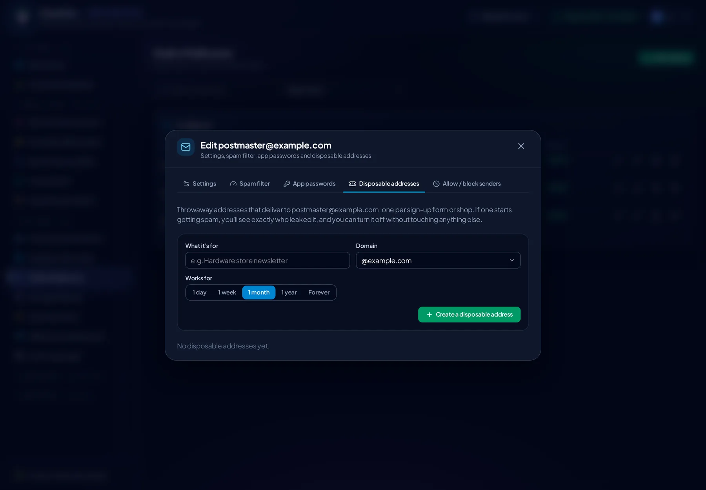</p>

<p align="center">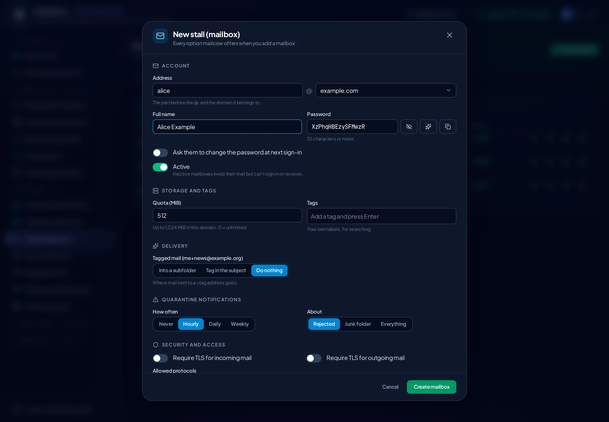</p>
<p align="center"></p>

### Ear Tags (Aliases)

An alias can deliver to a list of addresses, silently discard mail, or act as a spam or not-spam training address. You can also choose:
- whether the people it delivers to can send as it in webmail;
- whether it only accepts mail from this server's own users;
- private and public notes.

<p align="center">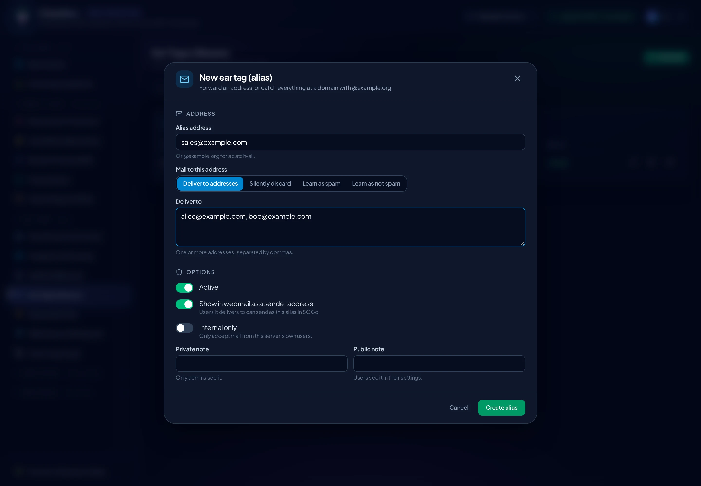</p>
<p align="center">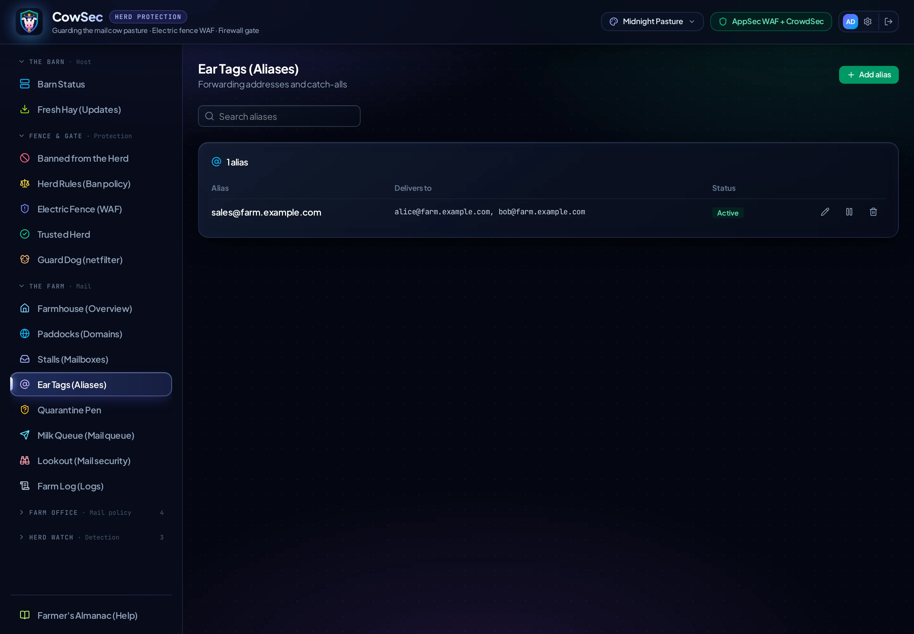</p>

### Milk Queue and Quarantine Pen

The queue shows why a message is waiting, for example a remote server refusing it or DNS problems. You can retry everything at once, or empty the queue.

Open a quarantined message to see:
- its score, rspamd's verdict and the sending IP;
- the headers that matter (From, Reply-To, Return-Path and authentication results);
- the text, always as plain text, so images, scripts and tracking pixels never load;
- **why it was held:** every rspamd rule that fired, with its score;
- **where the links really go:** links whose text shows a different address are flagged;
- attachments, with risky file types flagged.

From there you can release it, release it and teach rspamd it isn't spam, delete it, or always allow or block the sender (or their whole domain) for that mailbox.

<p align="center"></p>
<p align="center">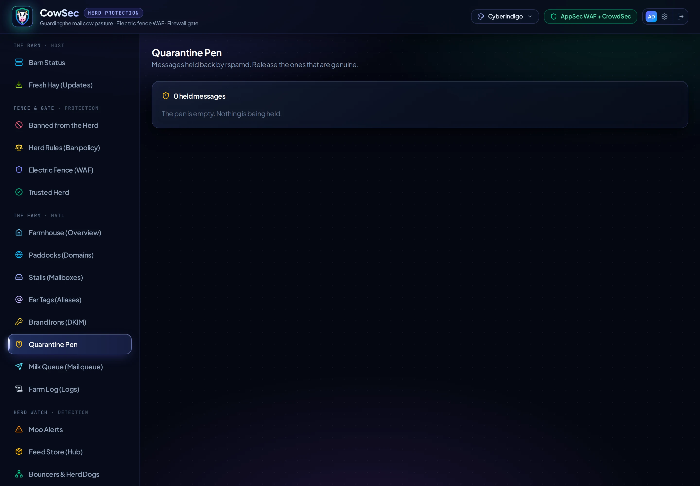</p>
<p align="center"></p>
<p align="center">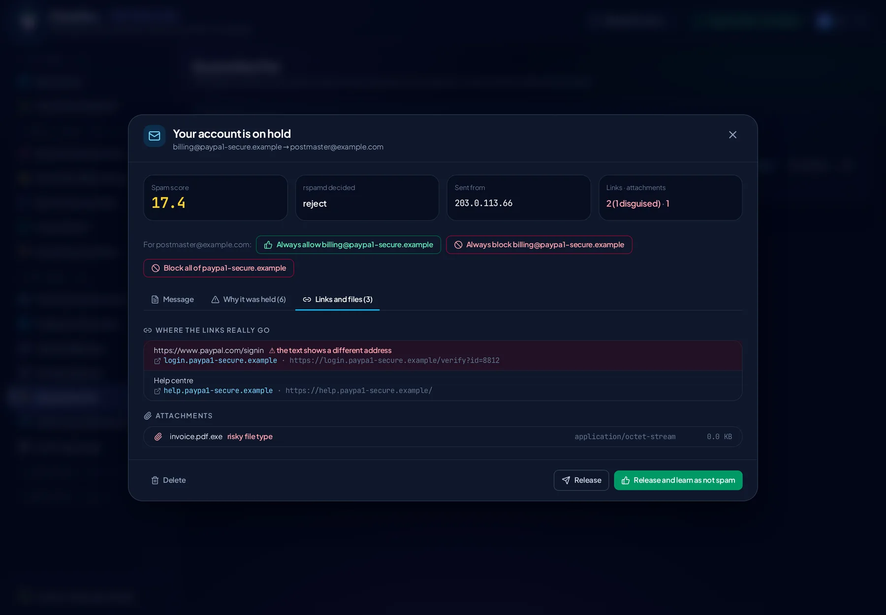</p>

### Mailbox security

The shield button on a mailbox, or the **Security** tab when editing one, shows:
- **sign-ins** from the last 30 days, with country flag, network, service, and which app password was used; sign-ins from a country the mailbox rarely uses are highlighted;
- **failed attempts** against the address, from mailcow's Postfix and Dovecot logs, grouped by address, with whether CrowdSec already bans each one and a button to ban it for 7 days.

**Lock down this mailbox** is for when an account may be in someone else's hands. It runs a checklist, each step optional:
1. Disable sign-in. Mail still arrives (mailcow's "login disallowed" state).
2. Require a new password at the next sign-in.
3. Pause every app password (paused, not deleted).
4. Sign out phones and tablets (clears ActiveSync devices).
5. Throttle sending to one message an hour.
6. Ban the suspicious addresses in CrowdSec for 24 hours, 7 days or 30 days.

CowSec remembers what it changed, so **Undo** puts each part back: sign-in, app passwords, the previous sending limit, and optionally the bans.

<p align="center"></p>
<p align="center">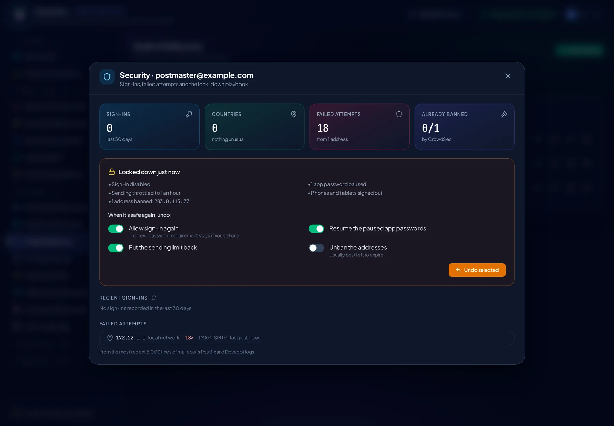</p>

### Lookout (Mail security)

One page for keeping watch:
- **Outbound mail by sender:** messages each signed-in user sent in the window of Postfix logs, with a rate per hour and how many addresses they sent from. A sudden jump, or one account sending from many addresses, is flagged as unusual.
- **Locked-down mailboxes**, with a shortcut to review or undo each.
- **The queue by sender**, and messages held back by a sending limit.
- **Admins and two-factor sign-in:** every mailcow admin and domain admin, and whether they use 2FA.
- **Password policy:** minimum length and required character types for mailbox and admin passwords.
- **Forwarding hosts:** servers allowed to pass mail on to this one, such as a backup MX.

<p align="center"></p>

### Show Ribbons (Deliverability)

Every domain gets a prize rosette, A to F, for how other mail servers will treat its mail. Each grade is built from checks: MX, SPF (strict or soft), DKIM, DMARC policy, MTA-STS (and whether its policy is actually reachable), TLS reporting, plus two for the server itself: reverse DNS, and seven blocklists. Every failing check says how to fix it.

Blocklist checks run a self-test first: a list that the server's DNS resolver can't query properly (common with public or filtering resolvers) shows as "?" rather than a false alarm.

<p align="center"></p>

### Farm Log

<p align="center">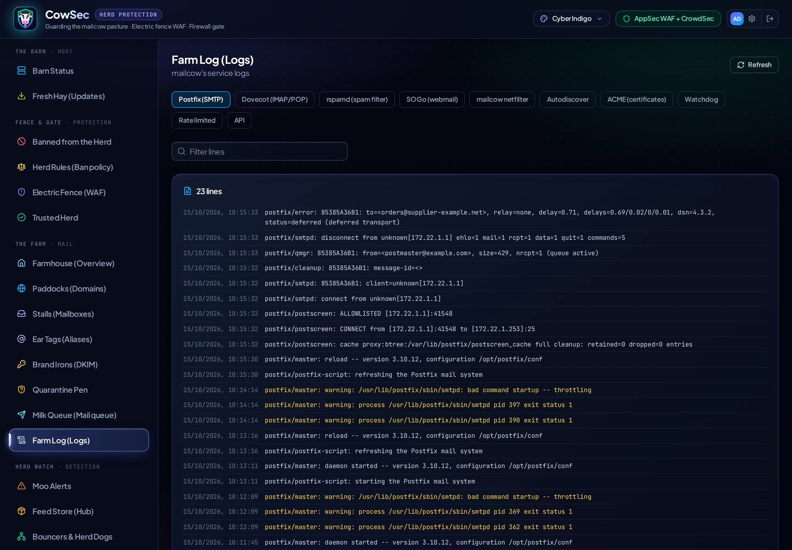</p>

### Farmhands (Domain admins)

**Open as** signs you into mailcow as that domain admin in a new tab, with a single-use link that's valid for 30 seconds, so you can see exactly what they see.

Create domain administrators, choose their domains, and switch each permission on or off: sync jobs, quarantine, log in as a user, spam lists, protocol access, relay hosts and so on. mailcow's API doesn't report permissions, so CowSec reads them from mailcow's database (read-only) and saves them through the API.

<p align="center"></p>

### Grazing Limits (Rate limits)

Set how many messages each domain or mailbox may send per second, minute, hour or day. A hijacked account then can't send thousands of spam messages from your IP before you notice. rspamd enforces the limits; 0 removes one.

<p align="center">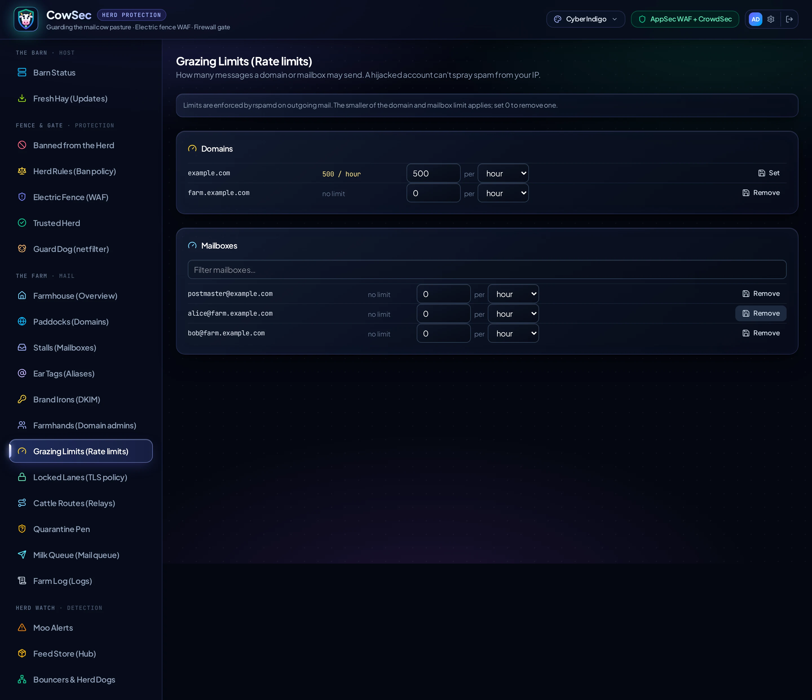</p>

### Locked Lanes (TLS policy)

Require encryption, a verified certificate or DANE when sending to particular domains or addresses, for example your bank or a partner. If the other side can't meet the policy, mail waits in the queue instead of going out unprotected.

<p align="center">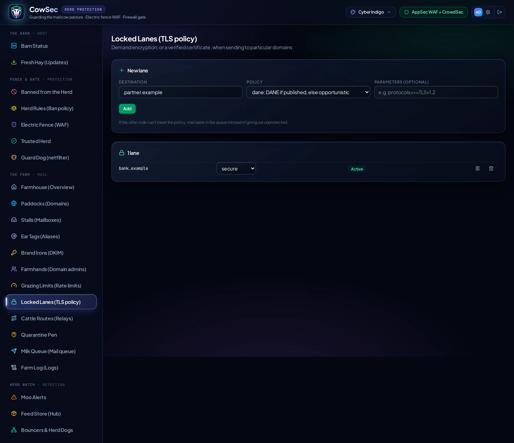</p>

### Cattle Routes (Relay hosts & transports)

- **Relay hosts** send mail through a smarthost. This is handy when your provider blocks outbound port 25. You can choose per domain which relay to use, or send directly.
- **Transports** route mail for particular destinations, or for everything hosted at one provider, to a specific next hop.

<p align="center">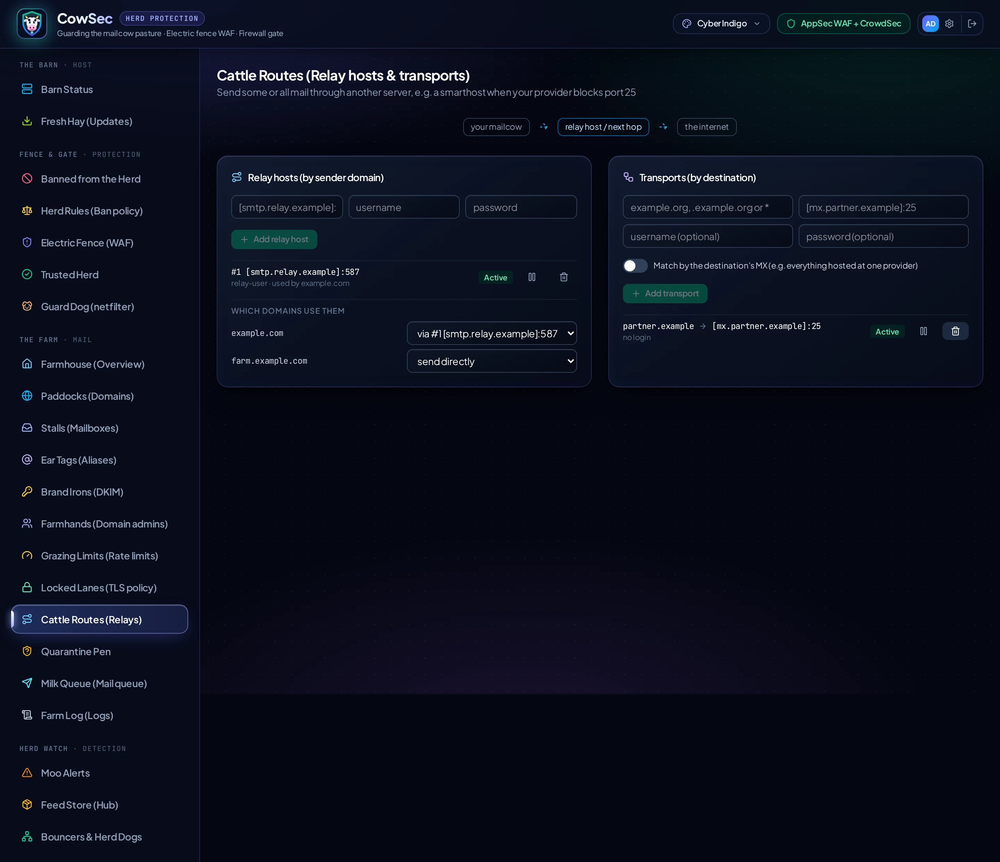</p>

### Guard Dog (mailcow netfilter)

mailcow has its own ban engine, *netfilter*. It is a separate guard from CrowdSec, so CowSec shows it under **Fence & Gate**. From this page you can:
- see netfilter's active and permanent bans;
- unban, whitelist or blacklist a network;
- edit its thresholds.

Choose how the two guards work together:

| Mode | What happens |
|---|---|
| **Side by side** (default) | netfilter bans in its own firewall chain and CrowdSec bans in `DOCKER-USER`. |
| **CrowdSec enforces** | netfilter keeps detecting but switches to mailcow's *manage externally* mode. Every minute CowSec turns its active bans and blacklist into CrowdSec decisions (reason `mailcow netfilter`). Every ban then shows in **Banned from the Herd**, under one firewall. Switching back hands enforcement back to netfilter and removes the imported decisions. |

In both modes:
- **Keep trusted lists in step** adds your **Trusted Herd** allowlist and local network to netfilter's whitelist, so neither guard bans them.
- Lifting a ban in **Banned from the Herd** lifts it in netfilter too.

<p align="center"></p>

## Limits

These are deliberately out of scope for now:
- **Mailbox users' own settings** (spam filters, app passwords, sieve) stay in SOGo and mailcow's user pages.
- **Domain admins** are a planned phase.
- **Rate limits, TLS policy maps, transports and relay hosts** are a planned phase.
- **mailcow's netfilter** coordination is a planned phase.
