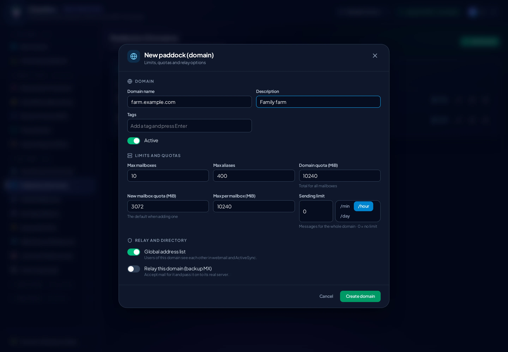
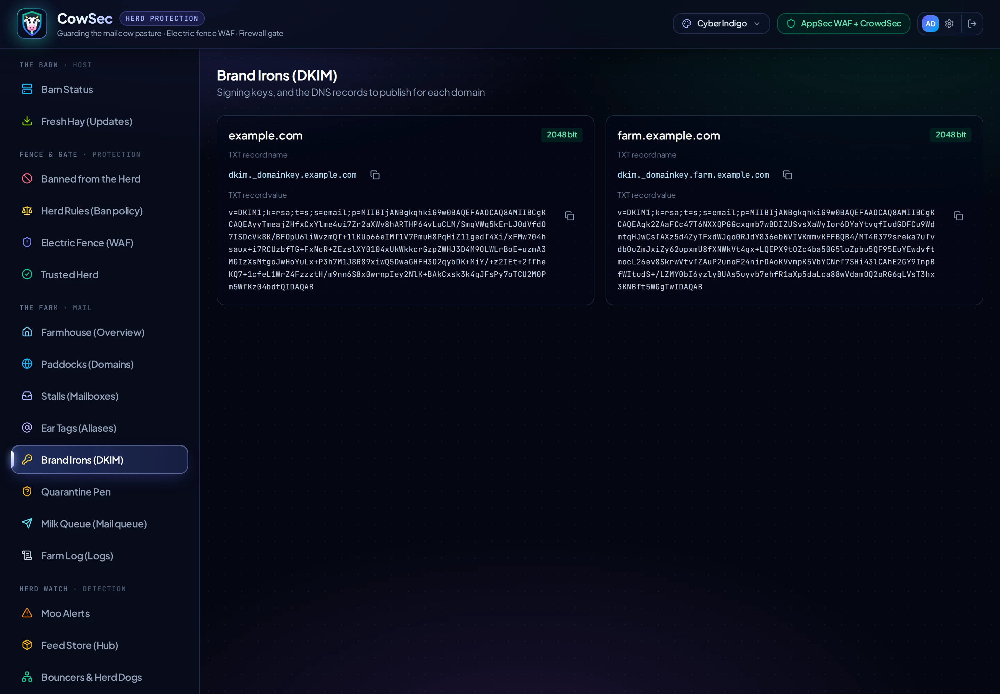

<p align="center"></p>

# Managing mailcow from CowSec

<p align="center"></p>

CowSec can run the day-to-day mailcow administration itself, so you rarely need mailcow's admin UI. With that UI limited to your LAN, or closed altogether, admin access goes through CowSec's 2FA sign-in, audit log and WAF.

The pages live under **The Farm · Mail** in the sidebar.

| Page | What you can do |
|---|---|
| **Farmhouse** | Container health, mailcow version, storage, queue and quarantine at a glance |
| **Paddocks (Domains)** | Add, enable/disable and delete domains; set mailbox, alias and quota limits |
| **Stalls (Mailboxes)** | Add mailboxes with a generated password, reset passwords, enable/disable, delete; quotas and last logins |
| **Ear Tags (Aliases)** | Forwarding addresses and catch-alls (`@example.org`) |
| **Brand Irons (DKIM)** | See each domain's DKIM key and the exact DNS record to publish, or generate one |
| **Quarantine Pen** | Release or delete messages rspamd held back |
| **Milk Queue (Mail queue)** | See stuck outgoing mail with the reason, retry, hold or delete |
| **Farm Log (Logs)** | postfix, dovecot, rspamd, SOGo, netfilter, ACME and more, with a filter |

## Turning it on

New installs: leave **Manage mailcow from CowSec** switched on in the setup wizard's *Protection* step.

Existing installs:

```bash
sudo cowsec-setup mailcow-api
```

This step does four things:
- **Reuses your key:** if mailcow already has an `API_KEY` in `mailcow.conf`, CowSec uses it, so your other tools keep working. Otherwise it generates one.
- **Allows local callers only:** `API_ALLOW_FROM` gains just `127.0.0.1`, `::1` and mailcow's Docker gateway (usually `172.22.1.1`). Calls from anywhere else are refused.
- **Stores the key root-only:** the key goes in `/etc/cowsec/mailcow.env` (mode 0600). It is never sent to the browser.
- **Applies the change:** if `mailcow.conf` changed, mailcow is restarted with `docker compose up -d`.

> [!IMPORTANT]
> mailcow's read-write API key is full administrative access to all mail on the server. CowSec only exposes a fixed set of validated operations. It never passes raw API calls through from the browser, and every change is recorded in CowSec's audit log (**Settings → Activity**).

## A tour

### Farmhouse

<p align="center"></p>

### Paddocks (Domains)

Add a domain with its limits. mailcow creates a DKIM key for it automatically.

<p align="center"></p>
<p align="center"></p>

### Stalls (Mailboxes)

New mailboxes get a strong generated password, which you can copy before saving. The key button sets a new password at any time.

<p align="center"></p>
<p align="center"></p>

### Ear Tags (Aliases)

<p align="center"></p>

### Brand Irons (DKIM)

Copy the record name and value straight into your DNS provider.

<p align="center"></p>

### Milk Queue and Quarantine Pen

The queue shows why a message is waiting, for example a remote server refusing it or DNS problems. You can retry everything at once.

<p align="center"></p>
<p align="center"></p>

### Farm Log

<p align="center"></p>

## Limits

These are deliberately out of scope for now:
- **Mailbox users' own settings** (spam filters, app passwords, sieve) stay in SOGo and mailcow's user pages.
- **Domain admins** are a planned phase.
- **Rate limits, TLS policy maps, transports and relay hosts** are a planned phase.
- **mailcow's netfilter** coordination is a planned phase.
