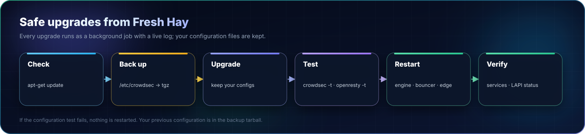
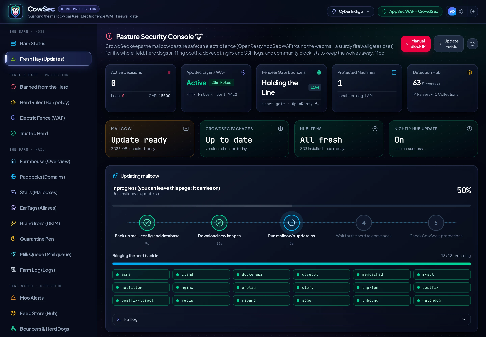
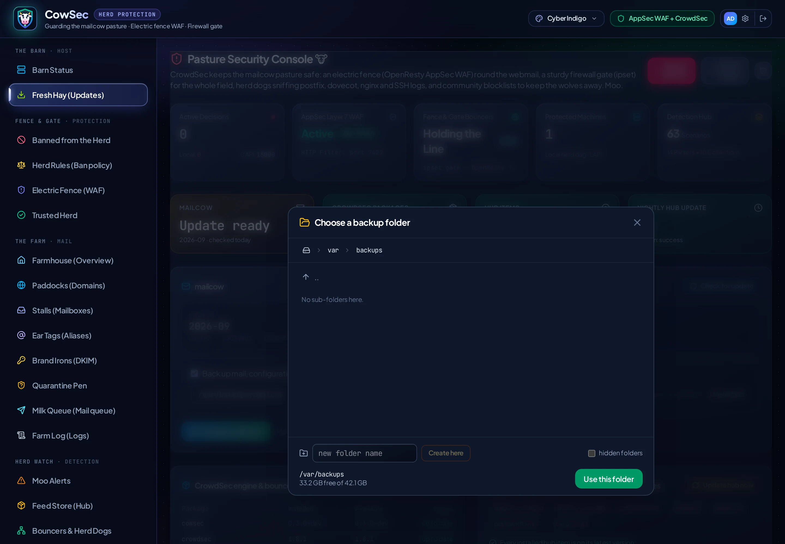

<p align="center"></p>

# Updating, reverting and uninstalling

## Updating CowSec

In the console, **Fresh Hay → CowSec** shows your version and the latest release from GitHub, with its notes. **Update CowSec** then runs as a staged job:
1. Downloads the package.
2. Checks it against the release's `SHA256SUMS`. If the check fails, it deletes the download and installs nothing.
3. Installs it with apt.
4. Waits for the console to come back.

Only the console restarts; mail and protection keep running. The page reloads by itself when the update is done.

While the repository is private, the server needs a token to see releases:
1. Create a fine-grained GitHub token with read-only **Contents** access to that one repository.
2. Paste it under **Release source**.

It is stored root-only in `/etc/cowsec/update.env` and is never shown again or sent back to the browser.

To update by hand instead:

```bash
sha256sum -c SHA256SUMS
sudo apt update && sudo apt install ./cowsec_<new-version>_amd64.deb
```

Settings, accounts, the ban policy and certificates are kept.

## Updating CrowdSec and the bouncers

<p align="center"><a href="assets/full/upgrade-flow.webp" title="Open full size"></a></p>

<p align="center"></p>

Use **Fresh Hay (Updates)** in the console:

| Action | What it does |
|---|---|
| **Check for new versions** | Runs `apt-get update`. |
| **Upgrade CrowdSec & bouncers** | Backs up `/etc/crowdsec` to `/root/crowdsec-backup-<time>.tgz`, then upgrades `crowdsec` and both bouncers, keeping your config files. It tests the config, restarts the engine and firewall bouncer, and reloads OpenResty only if its config passes. |
| **Update hub now** | `cscli hub update && cscli hub upgrade`, then reloads CrowdSec. |
| **Nightly auto-update** | Turns CrowdSec's own `crowdsec-hubupdate.timer` on or off. |

Upgrades are signed apt packages; OpenResty and cloudflared update with your normal system updates.

## Updating mailcow

**Fresh Hay → mailcow** checks for new mailcow releases (`update.sh --check`) and runs the update for you as a staged, animated job:

<p align="center"></p>

1. **Back up** mail, configuration and database with mailcow's own `backup_and_restore.sh` (optional, on by default).
2. **Download** the new images first (`update.sh --prefetch`), so the downtime window is short.
3. **Update** with `update.sh --force`. Mail is offline for a few minutes while containers restart.
4. **Wait for the herd**: every container is watched live until it is up and healthy.
5. **Check CowSec's protections**:
   - the edge still reaches mailcow's web server;
   - the firewall bouncer still covers `DOCKER-USER`;
   - CrowdSec still reads postfix and dovecot (container names are refreshed if they changed);
   - your DNS-01 certificates and SNI map are still in place.

<p align="center"></p>

Branch switches (stable ↔ nightly) are never automated. mailcow refuses them in unattended mode, so run `./update.sh` yourself for those.

### Where backups go

<p align="center"></p>

The default is `/var/backups/cowsec/mailcow`. Click the folder icon to browse the server and pick or create another folder. You can also choose how many days of backups to keep (`--delete-days`).

> [!NOTE]
> mailcow's backup script requires its backup folder to be readable and traversable by other users, because its containers write into it. CowSec keeps backups private by putting the default folder inside `/var/backups/cowsec`, which is root-only (0700). If you choose your own folder, place it inside a root-only parent as well.

### Updating from the terminal

`cd /opt/mailcow-dockerized && sudo ./update.sh` still works exactly as before. CowSec's changes live in places `update.sh` keeps. Afterwards, the **Barn Status** page shows whether everything came back.

## Changing your choices

```bash
sudo cowsec-setup access lan|wan|tunnel|local ...   # console access
sudo cowsec-setup reset-wizard                      # run the browser wizard again
sudo cowsec-setup appsec-curate                     # rebuild the mail WAF (also runs after hub updates)
```

Re-running the wizard is safe: every step is idempotent, and files are backed up before they change.

## Undoing the OpenResty edge

```bash
sudo cowsec-setup revert-edge
```

This stops OpenResty and restores the `mailcow.conf` from before CowSec first changed it, so mailcow's nginx takes 80/443 again. CrowdSec and the firewall bouncer keep running. If you used DNS-01, set `SKIP_LETS_ENCRYPT=n` in `mailcow.conf` and run `docker compose up -d` if you want mailcow's own Let's Encrypt back.

## Putting mailcow back as it was

```bash
sudo cowsec-setup restore-mailcow                 # from the snapshot taken at install
sudo cowsec-setup restore-mailcow --from FILE     # or a specific /var/backups/cowsec/pre-install-*.tar.gz
```

This restores mailcow's settings and certificates from the snapshot CowSec took before its first change: `mailcow.conf`, `extra.cf`, `docker-compose.override.yml` and `data/assets/ssl`. It also stops and disables the OpenResty edge so mailcow's own web server takes ports 80 and 443 again, then restarts mailcow. Today's versions of those files are kept alongside as `*.before-restore-<time>`. It asks you to type RESTORE first; add `--yes` to skip that.

CrowdSec and the firewall bouncer keep running, so the server stays protected. The snapshot also holds CrowdSec's configuration and the firewall rules from before the install, in case you want to compare.

## Uninstalling

```bash
sudo cowsec-setup restore-mailcow      # mailcow's settings as before CowSec (or just revert-edge)
sudo apt remove cowsec                 # stops the console; CrowdSec keeps protecting you
sudo apt purge cowsec                  # also removes /etc/cowsec and /var/lib/cowsec
```

CrowdSec, its bouncers, OpenResty and cloudflared are separate packages and stay installed. Remove them with apt if you no longer want them. To return to CrowdSec's stock ban profile, run `sudo cp /etc/crowdsec/profiles.yaml.pre-cowsec /etc/crowdsec/profiles.yaml && sudo rm /etc/crowdsec/scenarios/cowsec-auth-abroad.yaml && sudo systemctl reload crowdsec`.
