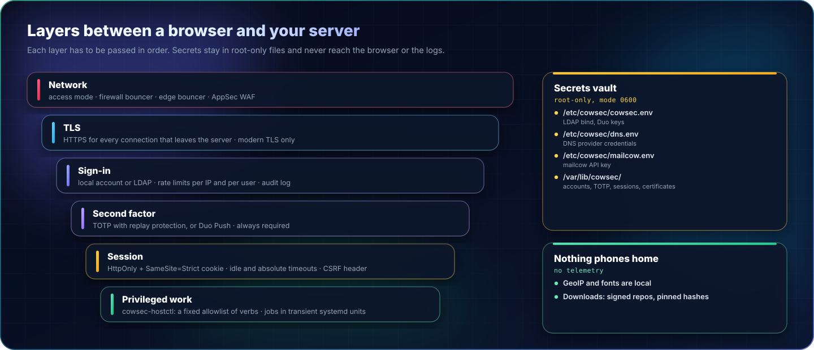
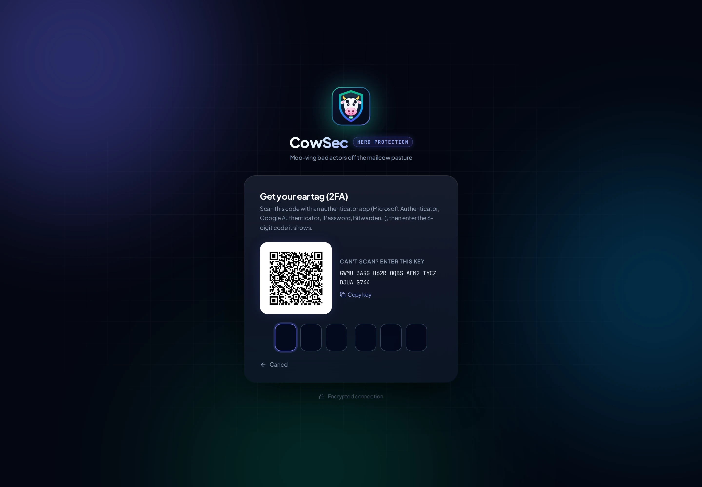
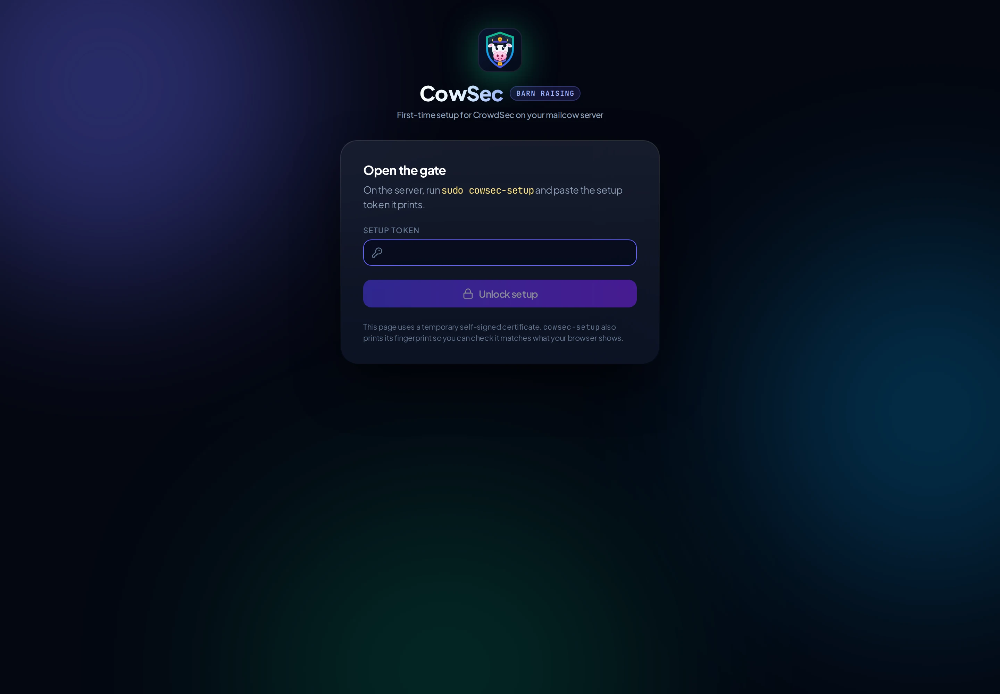

# Security model

## Privileges

`cowsec` runs as **root** under systemd. It has to manage CrowdSec, iptables, OpenResty and mailcow's configuration. The systemd unit enables `NoNewPrivileges`, `PrivateTmp`, `ProtectHome=read-only`, `ProtectKernelTunables` and `ProtectControlGroups`.

Anything that touches the system goes through **`/usr/lib/cowsec/cowsec-hostctl`**:

- It accepts a fixed allowlist of verbs: status, a handful of named service actions, policy apply, updates, named jobs, setup checks.
- It never runs a command string supplied by the browser.
- Long jobs (package upgrades, installation) run as transient systemd units and log to `/var/lib/cowsec/jobs/`.

cscli calls are built from validated arguments: hub item names come from cscli's own listings, IPs and ranges are parsed.

## Sign-in

- **Password step:** a local account (bcrypt, cost 12) or an LDAP bind. The LDAP path supports group restriction and LDAPS with name verification.
- **Second factor (always required):** TOTP with replay protection, or Duo Push for directory accounts.
- **Brute-force protection:** per-IP and per-user rate limits, and failed logins are written to `/var/lib/cowsec/audit.log`.
- **Session cookie:** `HttpOnly`, `SameSite=Strict`, and `Secure` behind TLS. It has an idle timeout (default 12h) and a maximum age (7d).
- **CSRF:** every state-changing request must carry the `X-CowSec-Request` header. A cross-site form can't set it.
- **Response headers:** `X-Frame-Options: DENY`, a strict CSP, and `nosniff`.
- **Trusted proxies:** the client IP is taken from `X-Forwarded-For` only when the request comes from a trusted proxy (`127.0.0.1` by default: the edge or cloudflared).

## Setup wizard

- It runs on its own listener (`:9443`) with a fresh self-signed certificate. The SHA-256 fingerprint is printed by `cowsec-setup` so you can check it.
- It is unlocked with a 192-bit one-time token from a root-only file. Wrong tokens are rate-limited.
- Every step of the wizard requires the unlock cookie and the CSRF header.
- Secrets submitted to the installer (DNS credentials, tunnel token) are written to a root-only pending file. That file is **deleted when the install job starts**. Secrets end up only in root-only files (`/etc/cowsec/dns.env`; the tunnel token in cloudflared's own service) and are redacted from job logs.
- After **Finish**, the token is deleted and the listener never starts again. `cowsec-setup reset-wizard` reopens it deliberately.

## What leaves the server

- **GeoIP:** lookups use the GeoLite2 databases CrowdSec already maintains locally. No IPs are sent to third parties.
- **Fonts:** bundled with the UI. No external requests from your browser.
- **CrowdSec Console:** not enrolled by CowSec. The community blocklist (CAPI) works without it.
- **Downloads during install:** signed apt repositories (CrowdSec, OpenResty, Cloudflare), and lego from GitHub with a **pinned SHA-256**.

## Files with secrets

| File | Contents |
|---|---|
| `/etc/cowsec/cowsec.env` | Settings; LDAP bind password and Duo keys if you use them (0600). |
| `/etc/cowsec/dns.env` | DNS provider credentials (0600). |
| `/etc/cowsec/mailcow.env` | mailcow API key, if mailcow management is enabled (0600). |
| `/var/lib/cowsec/auth-state.json` | Account hashes, TOTP secrets, sessions (0600). |
| `/var/lib/cowsec/certs/`, `/var/lib/cowsec/acme/` | Private keys (0600/0700). |

Back these up with the rest of the server, and treat them as secrets.
