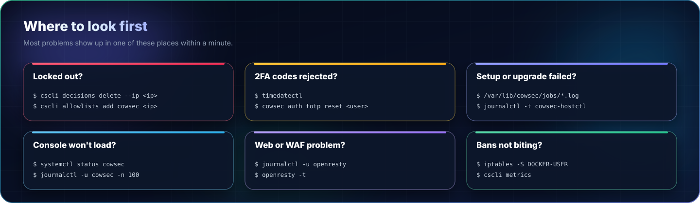

<p align="center"></p>

# Troubleshooting

<p align="center"><a href="assets/full/where-to-look.webp" title="Open full size"></a></p>

## Where to look

```bash
systemctl status cowsec;  journalctl -u cowsec -n 100
sudo cowsec-setup check
ls /var/lib/cowsec/jobs/            # logs of setup and update jobs
journalctl -t cowsec-hostctl        # every privileged action CowSec ran
sudo cscli metrics                  # acquisition, parsers, bouncers
```

## I locked myself out of mail or the console

<p align="center"></p>

In the console: **Banned from the Herd** → search for the IP → **Unblock**. Or from the server:

```bash
sudo cscli decisions list --ip <your-ip>
sudo cscli decisions delete --ip <your-ip>
sudo cscli allowlists add cowsec <your-ip> -d "my office"   # never ban it again
```

Your LAN ranges are always whitelisted.

## "TOTP code invalid" at sign-in

The server clock is off. `timedatectl` should show `System clock synchronized: yes`. On Proxmox/KVM, enable the precise clock option (`cowsec-setup reset-wizard`), or install chrony.

To reset someone's authenticator: `sudo cowsec auth totp reset <user>`.

## The wizard stopped during "OpenResty edge"

CowSec restores `mailcow.conf` and restarts mailcow's web server automatically. Check `journalctl -u openresty`. Usual causes: another web server on 80/443 (`ss -ltnp | grep -E ':80 |:443 '`), or a missing certificate path. Fix it, then run **Install** again.

## Certificates failed (DNS-01)

The job log shows lego's output. Common causes:

- The credentials lack DNS edit rights for that zone.
- The domain's DNS isn't hosted at that provider.
- A CAA record forbids Let's Encrypt.

Try **Test run (staging)** while you fix it.

## Bans don't stop mail traffic

Check that the firewall bouncer hooks Docker traffic: `sudo iptables -S DOCKER-USER | grep CROWDSEC`. If it's missing, `sudo systemctl restart crowdsec-firewall-bouncer`.

## Events are counted twice

If another acquisition file also reads mailcow's postfix or dovecot containers, every failed login counts twice. Setup warns about this. Remove the duplicate entries from `/etc/crowdsec/acquis.yaml` or `acquis.d/`.

## OpenResty fails with `module 'resty.http' not found`

The OpenResty bouncer needs the `lua-resty-http` library. Its package script downloads it from OpenResty's package server (`opm`) and silently ignores failures. CowSec checks for it and, if `opm` is unavailable, installs the same tagged release from GitHub (checksum pinned). To fix an older install by hand:

```bash
sudo opm get ledgetech/lua-resty-http=0.17.1 && sudo systemctl restart openresty
```

## "waiting for another apt/dpkg run to finish"

New cloud servers and VPSs often run unattended upgrades just after first boot. CowSec waits for them (up to 20 minutes) instead of failing. To see what's running, use `ps aux | grep -E 'apt|dpkg'`.

## "CrowdSec did not restart: … api.crowdsec.net …"

CrowdSec 1.7+ stops at startup if it can't sign in to its central API. Check DNS, any outbound firewall and `/etc/hosts`. On a deliberately offline server, comment out `credentials_path` under `online_client` in `/etc/crowdsec/config.yaml`.

## Installing mailcow: "the distribution's docker.io package is installed"

mailcow needs Docker CE 24 or newer, and Debian's `docker.io` package is older. Remove it first with `sudo apt remove docker.io`. CowSec then installs Docker CE from Docker's own repository.

## Debian 13: why the edge is nginx rather than OpenResty

Debian 13's apt checks repository signatures with `sqv`, which has rejected keys bound with SHA-1 since 1 February 2026. OpenResty's repository key still is ([openresty#1072](https://github.com/openresty/openresty/issues/1072)), so apt refuses OpenResty's packages.

CowSec doesn't weaken apt's signature policy, because that would affect every repository on the server. On Debian 13 it builds the edge from Debian's own packages instead: `nginx` with Debian's Lua module, plus CrowdSec's `crowdsec-nginx-bouncer`. That bouncer uses the same Lua library as the OpenResty one, so bans, the AppSec WAF and the mail WAF behave the same, and DNS-01 certificates and LAN or internet access to the console work as on the other systems.

Where to look on Debian 13: the config is in `/etc/nginx` (CowSec writes `nginx.conf`, `cowsec_mailcow_proxy.conf` and `sites/cowsec-*.conf`), logs are in `/var/log/nginx`, the service is `nginx` (`journalctl -u nginx`), and the bouncer's settings are in `/etc/crowdsec/bouncers/crowdsec-nginx-bouncer.conf`.

If nginx already serves other websites on the server, the wizard warns you first: the edge replaces nginx's main config (the original is kept as a backup), so those sites would stop. Move them, or turn the edge off.
